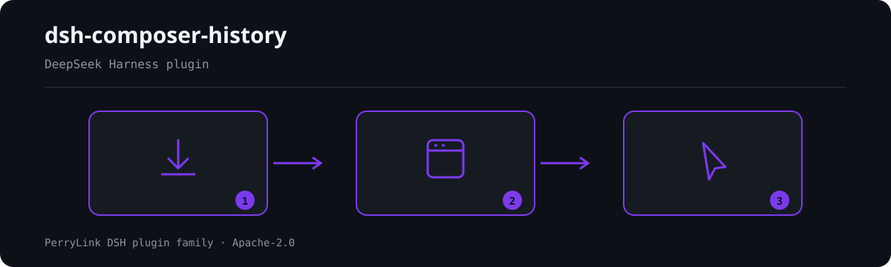

<div align="center">

# ⌨️ dsh-composer-history

> Release stamp: `0.8.8` (2026-10-04).
- **Canal 1024 store**: `npm i -g dsh1024` uma vez, depois `dsh1024 plugin --profile web add dsh-composer-history` (conta para o ranking de instalações do [deepseek1024.com](https://deepseek1024.com)).

**Histórico de entrada estilo terminal para o compositor da Web GUI do DeepSeek Harness.**

*Pressione ↑ como em um terminal — e mantenha seu rascunho pela metade seguro.*

[](LICENSE)
[](https://gitee.com/perrylink/dsh-composer-history)
[](https://github.com/topics/dsh-plugin)
[](https://github.com/PerryLink/dsh-plugin-doctor#verified-徽章)
[](https://dsh.market/)
[](#)
[](https://github.com/PerryLink/dsh-composer-history/actions)
[](https://github.com/PerryLink/dsh-composer-history/releases)
[](https://www.npmjs.com/package/dsh-composer-history)
[](https://www.npmjs.com/package/dsh-composer-history)
[](https://dshfind.com/pt/plugins/PerryLink/dsh-composer-history?ref=badge)

[English](README.md) · [简体中文](README-zh.md) · [Español](README-es.md) · [Português](README-pt.md) · [हिन्दी](README-hi.md)

```sh
dsh plugin --profile <name> add dsh-composer-history
```


</div>

---


**📖 Base de conhecimento do ecossistema** — dados medidos, não marketing: [guia de desenvolvimento · dados de seleção · critérios de manutenção](https://perrylink.github.io/dsh-plugin-guide/).

<!-- star-cta -->
## Install & uninstall

O pacote npm inclui os bundles já compilados; um checkout do código-fonte deve ser compilado primeiro (`pnpm run build`) — a verificação do pacote de cliente se recusa a iniciar com um bundle não compilado.

- **canal git** (último `main`): `dsh plugin --profile web add github:PerryLink/dsh-composer-history`.
- **canal npm** (versões publicadas): `dsh plugin --profile web add dsh-composer-history`.
- **canal tarball**: execute `pnpm pack` neste repositório e depois `dsh plugin --profile web add ./dsh-composer-history-<version>.tgz`.
- **desinstalar**: `dsh plugin --profile web remove dsh-composer-history` (ou remova a linha do patch do perfil).

## ⭐ 如果它帮到了你

Este plugin faz parte da [família de plugins DSH](https://github.com/PerryLink) (mais de 40, todos Apache-2.0). Se for útil, **deixe uma estrela**: não desbloqueia nada, mas ajuda a próxima pessoa a encontrá-lo.

*English:* part of a 95 plugin family for DeepSeek Harness. If it is useful, **a star helps the next person find it** — nothing is gated behind it.

## What is dsh-composer-history?

Histórico de entrada estilo terminal para o compositor da Web GUI do DeepSeek Harness.

Pressione ↑ como em um terminal — e mantenha seu rascunho pela metade seguro.



*Visão geral do fluxo: instalar → abrir painel → agir. Os exemplos abaixo usam a superfície real de comandos.*


*A mesma execução, animada.*

## Compatibility

| Surface | Status |
|---|---|
| Harness | DeepSeek Harness `dsh-v0.2.1-rc.2` (verificado 2026-10-18): `engines.dsh >=0.2.1-0 <0.3.0`; os caminhos de compatibilidade P0 têm testes de regressão. |
| Node | `^22.19.0 \|\| >=24.0.0` |
| Platforms | Somente Web GUI (plugin de cliente; armazenamento local do navegador; sem rede, sem código nativo) |
| Model | Qualquer um (sem requisições ao modelo — comportamento puramente de UI) |

A metade de navegador usa os pacotes de cliente publicados (`dsh-client-ui-conversation`, `dsh-client-ui-input-trigger`, `dsh-client-ui-settings`) e o `Context` do cordis; ela não depende mais do pacote removido `dsh-client-runtime`, então a superfície de cliente também se alinha com hosts `0.1.2-rc.1`.
A interceptação se ancora no DOM do compositor web: a superfície contenteditable `div[data-composer-input]` dentro de `[data-input-scroll]` (o compositor Lexical enviado desde 0.1.2-alpha.5 / 0.1.2-rc.1), mantendo também o compositor textarea legado dentro de `[data-input-scroll]` (linhas até 0.1.1-rc.2); outros textareas passam direto. O smoke de comportamento web em jsdom do fluxo de compatibilidade reafirma essa face identidade/texto/cursor contra o pacote empacotado.
0.1.2-rc.1 (adaptado em 2026-09-04): o envelope de sessão mantém seu campo ignorable apenas para compatibilidade de leitura de logs armazenados - o Session.append ainda não consegue estampá-lo, então o comportamento da porta não muda. Verificado em 2026-09-06 contra o checkout master do dsh-v0.1.7-alpha.1 (cadeia completa de portas + smoke de instalação de perfil).
0.1.5-rc.1 (adaptado em 2026-09-10): os pinos de dependências passam para a linha publicada 0.1.5-rc.1; nenhuma mudança de costura afeta o comportamento deste plugin.
0.1.5-rc.2 (adaptado em 2026-09-11): os pinos de dependências passam para a linha publicada 0.1.5-rc.2; nenhuma mudança de costura afeta o comportamento deste plugin.
0.1.7-alpha.1 (adaptado em 2026-10-04): a costura de configurações é substituída nas duas metades. A metade de host não registra mais um namespace `composer-history` pelo removido `ctx.settings.register(ns, schema, { base })`: nesta linha a superfície de configurações durável de um plugin É o seu próprio `Config` vivo. Cada ajuste é declarado `.volatile()`, o id da entrada de perfil (`composer-history`, o id de linha do bundle patch) nomeia o formulário, e `apply` reivindica a política de formulário gerado (`ctx.settings.configure({ auto: true }, ctx.fiber)`, de propriedade do effect para que um reload se registre de novo limpidamente). A metade de navegador lê a mesma entrada por `ctx.configForms.get('composer-history')` em vez do removido `ctx.settingsScope.bind({ namespace })`; a forma de snapshot/assinatura não muda, então a fiação é reinstalada a cada mudança confirmada. A superfície editável é preservada, não ampliada: todo campo que o antigo namespace expunha é volatile e nenhum campo novo passou a ser editável. Uma seção existente de `settings.yaml` chamada `composer-history` é migrada pelo próprio host para a entrada de perfil do mesmo id.

## What you get

`dsh-composer-history` leva o histórico de entrada de um terminal para o compositor da Web GUI do DeepSeek Harness:

1. **Recuperação por setas com prioridade de borda** — as setas ↑/↓ simples movem primeiro o cursor; a recuperação do histórico só dispara quando o cursor está na primeira/última linha. A primeira recuperação guarda `{draft, caret}`, e ao voltar à entrada mais recente (ou pressionar `Esc`) ambos são restaurados exatamente — nunca apagados.
2. **Histórico persistente** — cada mensagem enviada é anexada a um armazenamento local do navegador limitado, então a recuperação sobrevive a recarregamentos e alcança outras sessões.
3. **Busca reversa** — `Ctrl+R` (configurável) abre um painel de consulta sobre o histórico, os snippets e os templates combinados.
4. **Camada de entrada inteligente** — snippets `/save`/`/load`, templates de prompt com variáveis `{{workspace}}`/`{{session}}`/`{{draft}}` e insights de reutilização locais do navegador.
5. **Consciente do contexto deslizante** — os resumos de compactação entram na recuperação e na busca como entradas `[compacted] …`, e um aviso transitório anuncia cada compactação com um preenchimento de `/compact` em um clique.

Comportamento puramente de UI: sem eventos de sessão, sem mudanças no agent-loop, sem requisições ao modelo. O texto recuperado apenas entra no rascunho comum do compositor; ele chega ao modelo somente se *você* pressionar Enter.

## Quick start

```sh
dsh plugin --profile web add github:PerryLink/dsh-composer-history
```

```sh
# 1. install the bundle into your profile
dsh plugin --profile web add github:PerryLink/dsh-composer-history

# or from npm (published releases)
dsh plugin --profile web add dsh-composer-history

# 2. restart and verify the row
dsh --profile web --dump-config | grep -A3 'id: composer-history'
```

### Exemplos

São os pontos de entrada reais; instale e chame um.

#### Exemplo detalhado

**Comando**

~~~sh
/save ship-check --tag=release,ops
~~~

**Saída**

~~~text
snippet saved: ship-check
~~~

*Observado em `plugins/dsh-composer-history/README.md §Smart input layer (lines 199-205); code at src/client/index.ts:314-327`*

#### Ramo de falha

**Entrada**

~~~text
/load nope
~~~

**Saída**

~~~text
no snippet named nope (open Ctrl+R search to browse snippets)
~~~

*Observado em `plugins/dsh-composer-history/src/client/index.ts:330-333; plugins/dsh-composer-history/src/client/notice.ts:62-65`*

#### Exemplos breves

- `/load`
- `/compact`

## Configuration

Todos os ajustes são campos Schemastery `Config` (alteráveis pelo cordis.yml e pelo formulário de configurações da entrada; o patch de perfil é o documento persistido). Uma substituição direcionada por id substitui a linha inteira — repita cada chave de que precisar. Valores de enum inválidos interrompem toda a inicialização do dsh de forma ruidosa, e uma edição no formulário de configurações é validada pelo host antes de persistir.

| Key | Default | Meaning |
|---|---|---|
| `recallWithDraft` | `'save'` | Modo de recuperação (`save` / `gate`): `save` guarda um rascunho não vazio antes de recuperar; `gate` só recupera com rascunho vazio (controle estilo Claude/Codex) |
| `restoreOnEscape` | `true` | Restaurar o rascunho guardado quando `Esc` encerra a navegação |
| `edgeMode` | `'logical'` | Modo de detecção de borda (`logical` / `visual`): por linhas `\n` ou por linhas quebradas medidas |
| `enableCtrlAlias` | `true` | Fazer Ctrl+↑/↓ se comportar como as setas simples |
| `restoreCaret` | `true` | Restaurar também o cursor guardado ao chegar ao final / `Esc` |
| `upKey` | `'ArrowUp'` | `KeyboardEvent.key` que recupera para cima; `''` desativa |
| `downKey` | `'ArrowDown'` | `KeyboardEvent.key` que avança para o mais recente / restaura; `''` desativa |
| `escapeKey` | `'Escape'` | `KeyboardEvent.key` que sai da navegação; `''` desativa |
| `maxHistory` | `500` | Máximo de entradas recuperadas (mantêm-se as mais recentes); `0` = ilimitado |
| `includeKinds` | `['user']` | Tipos de nó de conversa admitidos no histórico (adicione `'steering'` para incluir mensagens steer) |
| `historyScope` | `'session'` | Escopo do histórico (`session` / `workspace`): `workspace` antepõe as mensagens de usuário de outras sessões listadas às da sessão atual |
| `persistHistory` | `true` | Anexar as mensagens enviadas ao armazenamento local do navegador |
| `maxPersisted` | `200` | Máximo de entradas persistidas; `0` = ilimitado |
| `enableSearch` | `true` | Ativar o painel de busca reversa `Ctrl+R` |
| `searchKeys` | `['Ctrl+R']` | Especificações de acorde que abrem a busca (modificadores `Ctrl`/`Alt`/`Meta`/`Shift` + um nome de tecla); uma especificação malformada faz o fiber do navegador falhar de forma ruidosa |
| `searchCaseSensitive` | `false` | Se a busca distingue maiúsculas de minúsculas |
| `includeCompactionSummaries` | `true` | Admitir resumos de checkpoint `[compacted] …` na recuperação e na busca |
| `showCompactionNotice` | `true` | Mostrar um aviso transitório quando um checkpoint de compactação aterrissa |
| `compactCommandText` | `'/compact'` | Comando slash que a ação "Compact now" do aviso preenche no compositor; `''` oculta a ação |
| `enableSnippets` | `true` | Ativar a biblioteca de snippets (`/save`, `/load`, seleção no painel de busca) |
| `maxSnippets` | `200` | Máximo de snippets armazenados; `0` = ilimitado |
| `enableTemplates` | `true` | Ativar a biblioteca de templates de prompt (variáveis preenchidas na inserção) |
| `enableInsights` | `true` | Ativar a dica de reutilização (estatísticas de uso locais) |
| `insightMinUses` | `2` | Usos mínimos antes de a dica de reutilização aparecer |
| `enableCompactionHighlight` | `true` | Marcar resumos `[compacted] …` de forma distinta no painel de busca |

## Tools & surfaces

| Surface | Kind | Notes |
|---|---|---|
| `ArrowUp` | keybinding | Recuperação ↑/↓ com prioridade de borda — guarda `{draft, caret}`, restaura ambos exatamente ao chegar ao final ou com `Esc` |
| `Ctrl+R` | keybinding | Painel de busca reversa sobre o histórico, os snippets e os templates combinados |
| `/save` | command | Salva o rascunho atual como um snippet com nome e tags |
| `/load` | command | Insere um snippet salvo no cursor |
| `templates` | UI | Exportar/importar templates de prompt como documento JSON (apenas com clique explícito) |
| `composer-history` | settings form | O formulário de `Config` vivo da própria entrada de perfil — leva a configuração resolvida (base do cordis.yml + substituições do perfil) para a metade do navegador |

## Keybindings

| Key | State | Behavior |
|---|---|---|
| ↑ | IDLE, cursor na primeira linha | guarda `{draft, caret}`, preenche a entrada mais recente, cursor ao final (sem histórico → passa) |
| ↑ | BROWSING, cursor na primeira linha | entrada mais antiga; segura na mais antiga (intercepta, sem mutação) |
| ↑ | cursor não está na primeira linha | totalmente liberado (o navegador move o cursor) |
| ↓ | IDLE | sempre liberado (movimento normal do cursor) |
| ↓ | BROWSING, cursor na última linha | entrada mais recente; na mais nova → restaura `savedDraft` + `savedCaret` → IDLE |
| ↓ | cursor não está na última linha | totalmente liberado |
| Esc | BROWSING (`restoreOnEscape: true`) | restaura `savedDraft` + `savedCaret` → IDLE, interceptado |
| Esc | caso contrário | liberado (a semântica de Escape de menus/popups não é tocada) |
| Ctrl+↑/↓ | `enableCtrlAlias: true` | igual às setas simples |
| `searchKeys` chord | compositor focado, fase `plain`, sem menu/seleção/IME | abre a busca reversa; a navegação termina, o texto exibido vira o rascunho |
| Shift/Alt/Meta+setas, IME, seleção | qualquer | sempre liberado |

`upKey`/`downKey`/`escapeKey`/`searchKeys` renomeiam as teclas acima; a política de modificadores (e a correspondência exata de modificadores do acorde de busca) não muda. Dentro do painel de busca: ↑/↓ movem a seleção (a linha selecionada rola para a vista), Enter preenche, Esc cancela, um clique escolhe, pressionar fora cancela; as substrings correspondentes são destacadas em cada linha.

## Reverse search

- **Abrir**: o acorde `searchKeys` com o compositor focado e a entrada em `plain` (um `Ctrl+R` aqui também interrompe a recarga de página do navegador — a tecla só é consumida dentro do compositor).
- **Filtrar**: correspondência de substring sobre o histórico combinado (sessão atual + entradas persistidas + de workspace); sensibilidade a maiúsculas conforme `searchCaseSensitive`; as substrings correspondentes são destacadas em cada linha.
- **Escolher**: Enter preenche o rascunho e move o cursor para o final — o mesmo caminho de escrita única `setDraft` da recuperação comum. O texto recuperado chega ao modelo apenas se você pressionar Enter depois.
- **Cancelar**: Esc ou pressionar fora do painel; o rascunho não é tocado.

## Smart input layer

Sobre o histórico estilo terminal, três bibliotecas locais do navegador transformam o compositor em uma superfície de entrada reutilizável. Tudo abaixo vive no `localStorage` (chaves `dsh.composer-history.snippets.v1`, `.templates.v1`, `.insights.v1`), nunca toca a rede, e cada interruptor é um campo `Config`.

**Snippets (biblioteca de comandos entre sessões)**

```text
/save ship-check --tag=release,ops
check the build, run the smoke suite, tag the release        ← o resto do rascunho é o snippet
/save ship-check                                             → "snippet saved: ship-check"
/load ship-check                                             → o snippet preenche o compositor
Ctrl+R → o painel de busca lista snippets (selo verde = nome) ao lado do histórico
```

- `/save <nome>` consome o Enter, armazena o rascunho (menos a linha de comando) sob um nome kebab-case com tags opcionais e limpa o compositor. Nada a salvar → um aviso de erro, o comando nunca envia.
- `/load <nome>` insere o snippet no cursor (substituição de todo o rascunho, cursor ao final) e conta o uso.
- Escopo: snippets salvos com um cwd de workspace têm escopo de workspace; os salvos sem um são globais. `maxSnippets` limita a biblioteca; salvamentos com o mesmo nome substituem.
- O plugin nunca envia: cada preenchimento cai no rascunho comum e seu Enter continua sendo seu.

**Templates de prompt com variáveis**

Templates são textos de prompt armazenados com marcadores `{{variable}}`. O painel de busca os lista com um selo roxo; escolher um preenche as variáveis a partir da sessão em tempo real e insere o resultado. Variáveis integradas: `{{workspace}}` (o cwd da sessão), `{{session}}` (o id da sessão), `{{draft}}` (o rascunho atual). Um template que referencia uma variável desconhecida falha de forma ruidosa com a lista de faltantes — um prompt pela metade é pior que um erro.

A biblioteca de templates exporta para e importa de um documento JSON (`composer-templates-v1`) pelos botões **Export templates / Import templates** do painel — uma ação explícita do usuário; o plugin nunca grava arquivos por conta própria.

**Insights de reutilização**

Cada mensagem de usuário recém-confirmada (e cada carga de snippet) registra um registro de uso local do navegador indexado por texto exato. Enquanto você digita, uma pequena dica sob o compositor informa `used M× in N sessions` quando o rascunho corresponde a um prompt usado em pelo menos `insightMinUses` (padrão 2) sessões. Alterne com `enableInsights`; as estatísticas contêm apenas os textos deduplicados e os contadores.

**Destaque de resumos de compactação**

`Ctrl+R` marca os resumos `[compacted] …` com um selo âmbar (o histórico permanece sem selo), snippets em verde, templates em roxo — a procedência do painel é visível de relance. Alterne com `enableCompactionHighlight`.

## Exportação e importação de backup

As quatro bibliotecas locais do navegador exportam e importam a partir de um único documento JSON versionado. As ações **Export JSON / Copy JSON / Import file / Paste JSON** do painel rodam totalmente no navegador: download ou cópia para a área de transferência ao exportar, seletor de arquivo ou texto colado ao importar — nada é enviado e não há RPC de host nem chamadas de rede.

**Forma do documento**

```json
{
  "schemaVersion": 1,
  "exportedAt": 1735689600000,
  "data": {
    "history": ["…"],
    "snippets": [{ "name": "…", "text": "…", "tags": [], "scope": "global", "createdAt": 0, "updatedAt": 0, "useCount": 0, "lastUsedAt": 0 }],
    "templates": [{ "name": "…", "text": "…", "description": "", "updatedAt": 0 }],
    "insights": [{ "text": "…", "sessions": [], "uses": 0, "lastUsedAt": 0 }]
  }
}
```

**Estratégia de mesclagem e conflitos**

- Entradas de histórico são strings simples e deduplicam por texto exato; uma entrada duplicada ou vazia é pulada, nunca sobrescrita.
- Snippets e templates são indexados por `name`; insights por `text` exato. Em conflito de mesma chave, a **marca de tempo mais nova vence** (`updatedAt` para snippets/templates, `lastUsedAt` para insights); uma importação mais antiga ou de marca igual é pulada, e chaves novas são anexadas.
- A importação respeita `maxPersisted` e `maxSnippets`; templates e insights param nos limites fixos do protocolo (`500` cada).
- O aviso de resultado informa quantos registros foram gravados e quantos foram pulados (antigos/duplicados).

**Versionamento de esquema**

`schemaVersion` começa em `1`. As importações rodam uma migração passo a passo (uma versão por vez) para que formatos futuros possam atualizar documentos antigos no lugar. Um documento cujo `schemaVersion` seja **mais novo** que o entendido por esta build é rejeitado com erro — nunca descartado silenciosamente nem mesclado parcialmente; uma versão antiga demais para migrar é rejeitada da mesma forma.

## Sliding context

O núcleo do harness dá a cada sessão do dsh uma janela de contexto deslizante, o mesmo fluxo de trabalho do Claude Code e do Codex: quando uma conversa se aproxima do limite de contexto do modelo (ou o provedor reporta um estouro), o harness **auto-compacta** — os turnos antigos são resumidos atrás de um marcador de checkpoint `compaction` que permanece visível na transcrição, o modelo mantém apenas o resumo mais a cauda recente, e a sessão continua. `/compact` dispara a mesma compactação sob demanda, e o marcador é renderizado como uma linha expansível "Context compacted".

`dsh-composer-history` conecta o compositor a esse fluxo para que o deslizamento da janela nunca custe seu histórico de digitação:

- **A recuperação sobrevive à compactação** — os turnos sombreados permanecem na conversa finalizada que a vista Chat publica, então ↑ ainda percorre cada mensagem enviada antes e depois de um checkpoint.
- **Os resumos entram no histórico** — o texto do resumo de cada checkpoint entra na recuperação ↑ e na busca `Ctrl+R` como uma entrada `[compacted] …` (alternância: `includeCompactionSummaries`), de modo que o contexto que o modelo já não vê literalmente fica a uma tecla de distância.
- **Aviso de compactação** — quando um checkpoint aterrissa com a página aberta, um snackbar transitório o anuncia (o momento "Auto-compacting conversation…" do Claude Code) com o trecho do resumo e uma ação de um clique **Fill `/compact`** (`showCompactionNotice`, `compactCommandText`); o preenchimento cai no rascunho comum, e somente seu Enter o envia.
- **Contagens de busca** — o painel `Ctrl+R` agora mostra uma linha de status ao vivo `N entries` / `N matches`, e entradas longas se limitam a duas linhas.

> A compactação em si (limiares, modelo de resumo, `/compact`) pertence aos plugins de compactação do núcleo do harness — este plugin apenas observa os marcadores de checkpoint que a projeção de conversa da vista Chat já expõe (`uiConversation.binding(id).target('chat').legacy.nodes`), então funciona sem nenhuma mudança de agent-loop ou requisição ao modelo.

## Permissions & data

- **Permissões**: o plugin declara `browser:local-storage` em seu manifest de workshop — nada mais. Sem rede, sem subprocessos, sem eventos de sessão.
- **Dados**: quatro chaves de `localStorage` do navegador — `dsh.composer-history.v1` (histórico de mensagens enviadas), `dsh.composer-history.snippets.v1` (textos de snippets + tags + contadores de uso), `dsh.composer-history.templates.v1` (textos de templates) e `dsh.composer-history.insights.v1` (textos de prompt deduplicados + contadores de uso por sessão). Todas limitadas, somente da mesma origem, nunca enviadas; cargas corrompidas são reiniciadas silenciosamente.
- **Visível para o modelo ⟺ você pressiona Enter**: o texto recuperado, as cargas de snippets, os preenchimentos de templates e o preenchimento de `/compact` caem no rascunho comum do compositor. Nada chega ao modelo até você pressionar Enter.

## Security boundaries

- **Somente UI, nunca aplicação.** O plugin edita apenas o rascunho do compositor; o sandbox, a aprovação e o sistema de sessões permanecem as autoridades de aplicação, e nenhum comando ou ferramenta é reivindicado ou contornado.
- **Nenhum conteúdo sai do navegador.** Histórico, snippets, templates e insights vivem no `localStorage`; nada é enviado e nenhuma requisição ao modelo ou chamada de rede é feita.
- **Falha ruidosa.** Valores de enum inválidos interrompem toda a inicialização do dsh; um acorde de busca malformado faz o fiber do navegador falhar — a má configuração nunca se degrada silenciosamente.
- **Tudo limitado.** `maxHistory`, `maxPersisted` e `maxSnippets` limitam as entradas retidas; cargas corrompidas ou estranhas são reiniciadas silenciosamente.
- **Zero efeitos colaterais na passagem.** O plugin intercepta apenas na fase de entrada `plain` e cede ao menu slash, aos popups de comando, à composição IME, às seleções de texto e às combinações de modificadores.

## Known limitations

- **Face DOM do compositor.** A interceptação se ancora em DOM privado do host: o `div[data-composer-input]` contenteditable dentro de `[data-input-scroll]` (host 0.1.2-alpha.5 / 0.1.2-rc.1 e posteriores); o compositor textarea legado dentro de `[data-input-scroll]` (linhas até 0.1.1-rc.2) continua correspondendo. Essa forma não é uma API publicada (a proposta upstream C3 registra que plugins só podem adivinhar o DOM do host), então uma mudança futura no DOM do host pode quebrar a interceptação silenciosamente — o smoke jsdom do fluxo de compatibilidade reafirma a face contra o pacote empacotado.
- **Linhas lógicas vs visuais.** O `logical` padrão se baseia em `\n` (uma mensagem longa com quebra automática conta como uma linha); `visual` mede quebras reais por um mirror oculto que copia a caixa computada da superfície contenteditable (busca binária O(linhas·log n) por verificação de borda, memoizado por rascunho/largura). A medição do mirror precisa de um motor de layout real — a matemática pura de spans é coberta por testes unitários, e os spans medidos no compositor Lexical seguem como melhor esforço (`logical` segue como padrão).
- **O histórico persistente é por navegador.** O armazenamento vive no `localStorage` de uma origem; nunca sincroniza entre navegadores ou máquinas. Cargas corrompidas são reiniciadas silenciosamente.
- **A pilha de desfazer inclui transações de recuperação.** Cada preenchimento/restauração é uma transação `setDraft` no registro de desfazer da máquina de entrada; Ctrl+Z retrocede pelas recuperações. A correção de precisão precisa da exposição do edit-range upstream.
- Recuperar uma entrada `/xxx` e pressionar Enter segue o caminho normal de claim/adjudication do comando (esperado, e Enter nunca é interceptado).
- Menus/popups e fases que não são `plain` sempre vencem; um envio confirmado e as trocas de sessão redefinem para IDLE.
- Os chips de referência (marcadores U+FFFC) viajam junto com o texto de rascunho recuperado/restaurado.
- `historyScope: 'workspace'` lê os alvos Chat de outras sessões listadas; uma sessão cuja vista Chat ainda não foi ativada nesta página não contribui.
- O painel de busca é DOM puro (sem dependência de React); renderiza todas as correspondências até o limite `maxHistory`.
- **A consciência de compactação é observacional.** Checkpoints que aterrissaram antes da instalação (ou antes de uma troca de sessão) nunca disparam um aviso; um checkpoint cujo evento de resumo caiu fora da janela carregada não contribui com nenhuma entrada `[compacted] …` (`summary: null`).
- A ação "Compact now" do aviso apenas *preenche* o texto de comando configurado no rascunho — o envio continua sendo seu Enter.
- **Snippets, templates e insights são locais do navegador.** Os nomes usam kebab-case (1..64 caracteres); as tags se limitam a 8 × 32 caracteres. As variáveis de template são resolvidas a partir da sessão em tempo real; `{{draft}}` é o rascunho no momento da escolha.

## Development

```sh
pnpm install           # node ^22.19 || >=24
pnpm run build         # tsc build + tsdown bundle (lib/)
pnpm run typecheck     # tsc --noEmit (src + tests)
pnpm test              # vitest run
pnpm run test:watch    # vitest watch
pnpm run test:coverage # vitest run --coverage
pnpm run check:readmes # README consistency gate
pnpm run verify:pack   # pack-surface check
```

## Topics

`deepseek-harness` · `dsh` · `dsh-plugin` · `web-gui` · `input-history` · `keyboard-shortcuts` · `compaction` · `sliding-context` · `typescript`

## Contributors

- [@PerryLink](https://github.com/PerryLink) — criador e mantenedor: recuperação por setas com prioridade de borda, histórico persistente, busca reversa, consciência do contexto deslizante, biblioteca de snippets, templates de prompt, insights de reutilização e os manifests `dsh.bundle` / `dshWorkshop`.

## PerryLink DSH Plugin Family

Este projeto faz parte da família de plugins do DeepSeek Harness da [PerryLink](https://github.com/PerryLink). O registro fica recolhido abaixo para que cada README mantenha uma primeira tela curta; expanda para ver cada linha e seu status.

<details>
<summary>Expandir todos os plugins</summary>

| Plugin | Status |
|---|---|
| **[dsh-aqua-input-check](https://github.com/PerryLink/dsh-aqua-input-check)** |  |
| **[dsh-archive-check](https://github.com/PerryLink/dsh-archive-check)** |  |
| **[dsh-auto-review](https://github.com/PerryLink/dsh-auto-review)** |  |
| **[dsh-autotier](https://github.com/PerryLink/dsh-autotier)** |  |
| **[dsh-bid-ca-precheck](https://github.com/PerryLink/dsh-bid-ca-precheck)** |  |
| **[dsh-bid-qual-check](https://github.com/PerryLink/dsh-bid-qual-check)** |  |
| **[dsh-cert-mcp](https://github.com/PerryLink/dsh-cert-mcp)** |  |
| **[dsh-checkpoint-rewind](https://github.com/PerryLink/dsh-checkpoint-rewind)** |  |
| **[dsh-click](https://github.com/PerryLink/dsh-click)** |  |
| **[dsh-composer-history](https://github.com/PerryLink/dsh-composer-history)** |  |
| **[dsh-contract-stance](https://github.com/PerryLink/dsh-contract-stance)** |  |
| **[dsh-customs-doc-check](https://github.com/PerryLink/dsh-customs-doc-check)** |  |
| **[dsh-data-quality](https://github.com/PerryLink/dsh-data-quality)** |  |
| **[dsh-demurrage-ledger](https://github.com/PerryLink/dsh-demurrage-ledger)** |  |
| **[dsh-doublecheck](https://github.com/PerryLink/dsh-doublecheck)** |  |
| **[dsh-drill-script-check](https://github.com/PerryLink/dsh-drill-script-check)** |  |
| **[dsh-eia-guide-check](https://github.com/PerryLink/dsh-eia-guide-check)** |  |
| **[dsh-emergency-plan](https://github.com/PerryLink/dsh-emergency-plan)** |  |
| **[dsh-essay-rubric-check](https://github.com/PerryLink/dsh-essay-rubric-check)** |  |
| **[dsh-evidence-check](https://github.com/PerryLink/dsh-evidence-check)** |  |
| **[dsh-export-ctl-check](https://github.com/PerryLink/dsh-export-ctl-check)** |  |
| **[dsh-fast](https://github.com/PerryLink/dsh-fast)** |  |
| **[dsh-fmea-table-check](https://github.com/PerryLink/dsh-fmea-table-check)** |  |
| **[dsh-forecast-penalty](https://github.com/PerryLink/dsh-forecast-penalty)** |  |
| **[dsh-fund-research](https://github.com/PerryLink/dsh-fund-research)** |  |
| **[dsh-github](https://github.com/PerryLink/dsh-github)** |  |
| **[dsh-gongwen-flow-check](https://github.com/PerryLink/dsh-gongwen-flow-check)** |  |
| **[dsh-gongwen-word-check](https://github.com/PerryLink/dsh-gongwen-word-check)** |  |
| **[dsh-guard-plan-qc](https://github.com/PerryLink/dsh-guard-plan-qc)** |  |
| **[dsh-hazchem-check](https://github.com/PerryLink/dsh-hazchem-check)** |  |
| **[dsh-hazplan-check](https://github.com/PerryLink/dsh-hazplan-check)** |  |
| **[dsh-hidden-risk-map](https://github.com/PerryLink/dsh-hidden-risk-map)** |  |
| **[dsh-hs-classify](https://github.com/PerryLink/dsh-hs-classify)** |  |
| **[dsh-icd-rule-check](https://github.com/PerryLink/dsh-icd-rule-check)** |  |
| **[dsh-industry-research](https://github.com/PerryLink/dsh-industry-research)** |  |
| **[dsh-lawcite-adapter](https://github.com/PerryLink/dsh-lawcite-adapter)** |  |
| **[dsh-laya](https://github.com/PerryLink/dsh-laya)** |  |
| **[dsh-lc-doc-check](https://github.com/PerryLink/dsh-lc-doc-check)** |  |
| **[dsh-learning-gap-check](https://github.com/PerryLink/dsh-learning-gap-check)** |  |
| **[dsh-library](https://github.com/PerryLink/dsh-library)** |  |
| **[dsh-local-ai](https://github.com/PerryLink/dsh-local-ai)** |  |
| **[dsh-lsp-actions](https://github.com/PerryLink/dsh-lsp-actions)** |  |
| **[dsh-mask](https://github.com/PerryLink/dsh-mask)** |  |
| **[dsh-mcp-panel](https://github.com/PerryLink/dsh-mcp-panel)** |  |
| **[dsh-medrec-qc](https://github.com/PerryLink/dsh-medrec-qc)** |  |
| **[dsh-memento](https://github.com/PerryLink/dsh-memento)** |  |
| **[dsh-nsfc-form-check](https://github.com/PerryLink/dsh-nsfc-form-check)** |  |
| **[dsh-nurse-record-check](https://github.com/PerryLink/dsh-nurse-record-check)** |  |
| **[dsh-observe](https://github.com/PerryLink/dsh-observe)** |  |
| **[dsh-origin-rvc-check](https://github.com/PerryLink/dsh-origin-rvc-check)** |  |
| **[dsh-ota-review-check](https://github.com/PerryLink/dsh-ota-review-check)** |  |
| **[dsh-output-styles](https://github.com/PerryLink/dsh-output-styles)** |  |
| **[dsh-paper-doc-adapter](https://github.com/PerryLink/dsh-paper-doc-adapter)** |  |
| **[dsh-permission-rules](https://github.com/PerryLink/dsh-permission-rules)** |  |
| **[dsh-permit-report-check](https://github.com/PerryLink/dsh-permit-report-check)** |  |
| **[dsh-pipeline-check](https://github.com/PerryLink/dsh-pipeline-check)** |  |
| **[dsh-pleading-draft](https://github.com/PerryLink/dsh-pleading-draft)** |  |
| **[dsh-plugin-doctor](https://github.com/PerryLink/dsh-plugin-doctor)** |  |
| **[dsh-plugin-guide](https://github.com/PerryLink/dsh-plugin-guide)** |  |
| **[dsh-plugin-kit](https://github.com/PerryLink/dsh-plugin-kit)** |  |
| **[dsh-plugin-upgrade](https://github.com/PerryLink/dsh-plugin-upgrade)** |  |
| **[dsh-policy-brief-draft](https://github.com/PerryLink/dsh-policy-brief-draft)** |  |
| **[dsh-power-loss-split](https://github.com/PerryLink/dsh-power-loss-split)** |  |
| **[dsh-power-ticket-check](https://github.com/PerryLink/dsh-power-ticket-check)** |  |
| **[dsh-ppap-check](https://github.com/PerryLink/dsh-ppap-check)** |  |
| **[dsh-protest-deadline](https://github.com/PerryLink/dsh-protest-deadline)** |  |
| **[dsh-railway-window](https://github.com/PerryLink/dsh-railway-window)** |  |
| **[dsh-repair-order-qc](https://github.com/PerryLink/dsh-repair-order-qc)** |  |
| **[dsh-research-report](https://github.com/PerryLink/dsh-research-report)** |  |
| **[dsh-review-reply-check](https://github.com/PerryLink/dsh-review-reply-check)** |  |
| **[dsh-rulefile-check](https://github.com/PerryLink/dsh-rulefile-check)** |  |
| **[dsh-safety-brief-check](https://github.com/PerryLink/dsh-safety-brief-check)** |  |
| **[dsh-score](https://github.com/PerryLink/dsh-score)** |  |
| **[dsh-session-sync](https://github.com/PerryLink/dsh-session-sync)** |  |
| **[dsh-site-log-check](https://github.com/PerryLink/dsh-site-log-check)** |  |
| **[dsh-skill-pack-security](https://github.com/PerryLink/dsh-skill-pack-security)** |  |
| **[dsh-soe-decision-check](https://github.com/PerryLink/dsh-soe-decision-check)** |  |
| **[dsh-soilwater-check](https://github.com/PerryLink/dsh-soilwater-check)** |  |
| **[dsh-sop-sync-check](https://github.com/PerryLink/dsh-sop-sync-check)** |  |
| **[dsh-spc-gbt-adapter](https://github.com/PerryLink/dsh-spc-gbt-adapter)** |  |
| **[dsh-talk](https://github.com/PerryLink/dsh-talk)** |  |
| **[dsh-tender-extract](https://github.com/PerryLink/dsh-tender-extract)** |  |
| **[dsh-tender-matrix](https://github.com/PerryLink/dsh-tender-matrix)** |  |
| **[dsh-test-drive](https://github.com/PerryLink/dsh-test-drive)** |  |
| **[dsh-ticktick](https://github.com/PerryLink/dsh-ticktick)** |  |
| **[dsh-translate](https://github.com/PerryLink/dsh-translate)** |  |
| **[dsh-warranty-calc](https://github.com/PerryLink/dsh-warranty-calc)** |  |
| **[dsh-budget](https://github.com/PerryLink/dsh-budget)** | 🧊 CONGELADO — ver o README do repositório |
| **[dsh-claude-move](https://github.com/PerryLink/dsh-claude-move)** | 🧊 CONGELADO — ver o README do repositório |
| **[dsh-defend](https://github.com/PerryLink/dsh-defend)** | 🧊 CONGELADO — ver o README do repositório |
| **[dsh-draw](https://github.com/PerryLink/dsh-draw)** | 🧊 CONGELADO — ver o README do repositório |
| **[dsh-reach](https://github.com/PerryLink/dsh-reach)** | 🧊 CONGELADO — ver o README do repositório |
| **[dsh-background-agents](https://github.com/PerryLink/dsh-background-agents)** | 🚫 RETIRADO — ver o README do repositório |
| **[dsh-session-pin](https://github.com/PerryLink/dsh-session-pin)** | 🚫 RETIRADO — ver o README do repositório |
| **[dsh-team-rooms](https://github.com/PerryLink/dsh-team-rooms)** | 🚫 RETIRADO — ver o README do repositório |

</details>

## License

[Apache License 2.0](LICENSE) © 2026 dsh-composer-history contributors

### Instalar a partir do mercado do DSH Desktop

Todos os plugins PerryLink podem ser explorados no mercado integrado do DSH Desktop: **Market → Sources → add source → colar** `https://perrylink-dsh-catalog.perrylink.workers.dev/catalog-source.json` **→ selecionar**. A instalação continua passando pela verificação de identidade npm do mercado e pela sua confirmação.
