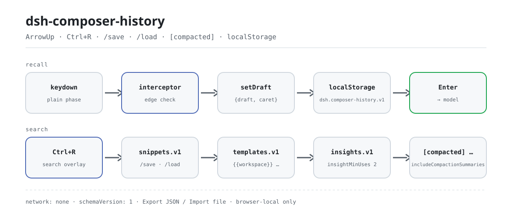

<div align="center">

<picture>
  <source media="(prefers-color-scheme: dark)" srcset="docs/assets/dsh-composer-history-flow-dark.svg">
  
</picture>

# dsh-composer-history

**Pulsa ↑ como en una terminal — y conserva intacto el borrador a medio escribir.**

Historial de entrada estilo terminal para el compositor de la Web GUI de DeepSeek Harness: recuperación con flechas con prioridad de borde, persistencia local del navegador, búsqueda inversa con `Ctrl+R` y bibliotecas de fragmentos y plantillas, todo dentro del borrador ordinario.

[Instalar](#instalación-en-tres-pasos) · [Configuración](#configuración) · [FAQ](#faq) · [简体中文](README.md) · [English](README.en.md) · [Español](README.es.md) · [Português](README.pt.md) · [हिन्दी](README.hi.md)

[](LICENSE)
[](#compatibilidad)
[](https://www.npmjs.com/package/dsh-composer-history)
[](https://github.com/PerryLink/dsh-composer-history/actions/workflows/ci.yml)
[](#compatibilidad)

[](https://github.com/PerryLink/dsh-composer-history/stargazers)
[](https://www.npmjs.com/package/dsh-composer-history)
[](https://dshfind.com/plugins/PerryLink/dsh-composer-history?ref=badge)
[](https://securityscorecards.dev/viewer/?uri=github.com/PerryLink/dsh-composer-history)
[](https://dsh.market/)
[](https://gitee.com/perrylink/dsh-composer-history)

```sh
dsh plugin --profile <name> add dsh-composer-history
```

</div>

<sub>Plugin de la comunidad, no afiliado a DeepSeek. Repositorio canónico: <https://github.com/PerryLink/dsh-composer-history> (Gitee es un espejo).</sub>

## Qué es

Lleva el historial de entrada de una terminal al compositor web de DeepSeek Harness: con el cursor en la primera línea, ↑ recupera el último mensaje que enviaste; en cualquier otra posición, ↑/↓ mueven el cursor como siempre y nada se apropia de la tecla.

La primera recuperación guarda `{draft, caret}`, y al volver a la entrada más reciente (o pulsar `Esc`) se restauran ambos exactamente — tu borrador a medio escribir nunca se borra. El historial vive en el almacenamiento local del navegador, así que la recuperación sobrevive a las recargas y abarca sesiones; `Ctrl+R` busca a la vez en historial, fragmentos y plantillas. Cuando el harness autocomprime el contexto, el resumen de cada punto de control entra en la recuperación y la búsqueda como entrada `[compacted] …`, y un aviso transitorio ofrece rellenar `/compact` con un clic.

Comportamiento puramente de UI: sin eventos de sesión, sin cambios en el agent-loop, sin peticiones al modelo. El texto recuperado solo entra en el borrador ordinario del compositor, y llega al modelo únicamente si tú pulsas Enter.

## Instalación en tres pasos

1. **Instalar** (elige un canal):

   ```sh
   # canal git (último main; equivale a git+https://github.com/PerryLink/dsh-composer-history.git)
   dsh plugin --profile web add github:PerryLink/dsh-composer-history
   # canal npm (versiones publicadas)
   dsh plugin --profile web add dsh-composer-history
   # canal tarball: tras pnpm pack en este repositorio
   dsh plugin --profile web add ./dsh-composer-history-<version>.tgz
   ```

   El paquete npm incluye los bundles ya construidos; un checkout del código fuente debe construirse antes (`pnpm run build`) — la comprobación del paquete cliente se niega a arrancar con un bundle sin construir.

2. **Configuración mínima** (los valores por defecto bastan; el patch del bundle inserta una fila y el esquema `Config` aporta el resto):

   ```yaml
   - insert:
       - id: composer-history
         name: dsh-composer-history
   ```

3. **Verificar que se monta**:

   ```sh
   dsh --profile web --dump-config | grep -A3 'id: composer-history'
   ```

   La salida debe mostrar `id: composer-history` y `name: dsh-composer-history`. Tras reiniciar, pon el cursor en la primera línea del compositor web y pulsa ↑: el mensaje de usuario más reciente rellena el borrador.

**Desinstalar**: `dsh plugin --profile web remove dsh-composer-history` (o elimina la fila del patch del perfil).

<details>
<summary>Instalar desde el mercado de DSH Desktop</summary>

Todos los plugins de PerryLink aparecen en el mercado integrado de DSH Desktop: **Mercado → Fuentes → Añadir fuente → pegar** `https://perrylink-dsh-catalog.perrylink.workers.dev/catalog-source.json` **→ seleccionar**. La instalación sigue requiriendo la verificación de identidad npm del mercado y tu confirmación.

</details>

## Capacidades clave

`dsh-composer-history` hace una sola cosa: que el compositor recuerde lo que enviaste y te lo devuelva intacto cuando lo necesites.

1. **Recuperación por flechas con prioridad de borde** — las flechas ↑/↓ simples mueven primero el cursor; la recuperación del historial solo se activa cuando el cursor está en la primera/última línea. La primera recuperación guarda `{draft, caret}`, y al volver a la entrada más reciente (o pulsar `Esc`) se restauran ambos exactamente — nunca se borran.
2. **Historial persistente** — cada mensaje enviado se añade a un almacén local del navegador acotado, de modo que la recuperación sobrevive a las recargas y llega a otras sesiones.
3. **Búsqueda inversa** — `Ctrl+R` (configurable) abre un panel de consulta sobre el historial, los fragmentos y las plantillas combinados.
4. **Capa de entrada inteligente** — fragmentos `/save`/`/load`, plantillas de prompt con variables `{{workspace}}`/`{{session}}`/`{{draft}}` e información de reutilización local del navegador.
5. **Consciente del contexto deslizante** — los resúmenes de compactación se unen a la recuperación y la búsqueda como entradas `[compacted] …`, y un aviso transitorio anuncia cada compactación con un relleno de `/compact` de un clic.
6. **Copia de seguridad JSON versionada** — exporta/importa las cuatro bibliotecas (historial, fragmentos, plantillas, información de uso) como un único documento con versión de esquema; descarga o copia al exportar, archivo o pegado al importar.

Comportamiento puramente de UI: sin eventos de sesión, sin cambios en el agent-loop, sin peticiones al modelo. El texto recuperado solo entra en el borrador ordinario del compositor; llega al modelo únicamente si *tú* pulsas Enter.

```text
keydown ──interceptor──▶ setDraft ──▶ draft ──Enter──▶ model
                            ▲                              │
                            └──── localStorage ◀───────────┘
                                  dsh.composer-history.v1 · snippets.v1
                                  templates.v1 · insights.v1
```

### Superficie de comandos y herramientas

| Superficie | Tipo | Notas |
|---|---|---|
| `ArrowUp` | keybinding | Recuperación ↑/↓ con prioridad de borde — guarda `{draft, caret}` y restaura ambos exactamente al llegar al final o pulsar `Esc` |
| `Ctrl+R` | keybinding | Panel de búsqueda inversa sobre historial, fragmentos y plantillas combinados |
| `/save` | command | Guarda el borrador actual como fragmento con nombre y etiquetas |
| `/load` | command | Inserta un fragmento guardado en el cursor |
| `templates` | UI | Exportación/importación de copia de seguridad JSON versionada de historial, fragmentos, plantillas e información de uso (solo con clic explícito) |
| `composer-history` | settings form | El formulario `Config` vivo de la propia fila del perfil — lleva la configuración resuelta (base de cordis.yml + overrides del perfil) a la mitad del navegador |

### Atajos de teclado

| Tecla | Estado | Comportamiento |
|---|---|---|
| ↑ | IDLE, cursor en la primera línea | guarda `{draft, caret}`, rellena la entrada más reciente, cursor al final (sin historial → pasa) |
| ↑ | BROWSING, cursor en la primera línea | entrada más antigua; se detiene en la más antigua (intercepta, sin mutación) |
| ↑ | cursor fuera de la primera línea | liberado por completo (el navegador mueve el cursor) |
| ↓ | IDLE | siempre liberado (movimiento normal del cursor) |
| ↓ | BROWSING, cursor en la última línea | entrada más reciente; en la más reciente → restaura `savedDraft` + `savedCaret` → IDLE |
| ↓ | cursor fuera de la última línea | liberado por completo |
| Esc | BROWSING (`restoreOnEscape: true`) | restaura `savedDraft` + `savedCaret` → IDLE, interceptado |
| Esc | en otro caso | liberado (la semántica de Escape de menús y popups no cambia) |
| Ctrl+↑/↓ | `enableCtrlAlias: true` | igual que las flechas simples |
| `searchKeys` chord | compositor enfocado, fase `plain`, sin menú/selección/IME | abre la búsqueda inversa; la navegación termina y el texto mostrado pasa a ser el borrador |
| Shift/Alt/Meta+flechas, IME, selección | cualquiera | siempre liberado |

`upKey`/`downKey`/`escapeKey`/`searchKeys` renombran las teclas de arriba; la política de modificadores (y la coincidencia exacta del chord de búsqueda) no cambia. Dentro del panel de búsqueda: ↑/↓ mueven la selección de coincidencias (la fila seleccionada se desplaza a la vista), Enter rellena, Esc cancela, un clic elige y un clic fuera cancela; las subcadenas coincidentes se resaltan en cada fila.

### Ejemplos

Son los puntos de entrada reales; instala y llama a uno.

**Ejemplo detallado** — comando `/save`, entrada:

```sh
/save ship-check --tag=release,ops
```

Salida:

```text
snippet saved: ship-check
```

*Observado en `plugins/dsh-composer-history/README.md §Smart input layer (lines 199-205); code at src/client/index.ts:314-327`*

**Rama de fallo** — entrada:

```text
/load nope
```

Salida:

```text
no snippet named nope (open Ctrl+R search to browse snippets)
```

*Observado en `plugins/dsh-composer-history/src/client/index.ts:330-333; plugins/dsh-composer-history/src/client/notice.ts:62-65`*

**Ejemplos breves**: `/load` · `/compact`

## Búsqueda inversa

- **Abrir**: el chord `searchKeys` con el compositor enfocado y la entrada en fase `plain` (aquí `Ctrl+R` también detiene la recarga de página del navegador — la tecla solo se consume dentro del compositor).
- **Filtrar**: coincidencia por subcadena sobre el historial combinado (sesión actual + persistido + entradas del espacio de trabajo); la sensibilidad a mayúsculas la decide `searchCaseSensitive`; las subcadenas coincidentes se resaltan en cada fila.
- **Elegir**: Enter rellena el borrador y lleva el cursor al final — la misma única ruta de escritura `setDraft` que la recuperación ordinaria. El texto recuperado llega al modelo solo si después pulsas Enter.
- **Cancelar**: Esc o un clic fuera del panel; el borrador no se toca.

## Capa de entrada inteligente

Sobre el historial estilo terminal, tres bibliotecas locales del navegador convierten el compositor en una superficie de entrada reutilizable. Todo lo siguiente vive en `localStorage` (claves `dsh.composer-history.snippets.v1`, `.templates.v1`, `.insights.v1`), nunca toca la red, y cada interruptor es un campo `Config`.

**Fragmentos (biblioteca de comandos entre sesiones)**

```text
/save ship-check --tag=release,ops
check the build, run the smoke suite, tag the release        ← el resto del borrador es el fragmento
/save ship-check                                             → "snippet saved: ship-check"
/load ship-check                                             → el fragmento rellena el compositor
Ctrl+R → el panel de búsqueda lista fragmentos (insignia verde = nombre) junto al historial
```

- `/save <nombre>` consume el Enter, guarda el borrador (menos la línea de comando) bajo un nombre kebab-case con etiquetas opcionales y vacía el compositor. Nada que guardar → aviso de error, el comando nunca se envía.
- `/load <nombre>` inserta el fragmento en el cursor (reemplazo de todo el borrador, cursor al final) y cuenta el uso.
- Alcance: los fragmentos guardados con un cwd de espacio de trabajo son de ese espacio; los guardados sin él son globales. `maxSnippets` acota la biblioteca; guardar con el mismo nombre reemplaza.
- El plugin nunca envía: cada relleno cae en el borrador ordinario y tu Enter sigue siendo tuyo.

**Plantillas de prompt con variables**

Las plantillas son textos de prompt guardados con marcadores `{{variable}}`. El panel de búsqueda las lista con insignia morada; al elegir una se rellenan las variables desde la sesión en vivo y se inserta el resultado. Variables integradas: `{{workspace}}` (el cwd de la sesión), `{{session}}` (el id de sesión), `{{draft}}` (el borrador actual). Una plantilla con una variable desconocida falla ruidosamente con la lista de faltantes — un prompt a medio rellenar es peor que un error.

Toda la biblioteca — historial, fragmentos, plantillas e información de uso — se exporta e importa como un único documento JSON versionado mediante las acciones **Export JSON / Import file** del panel; ver **Exportación e importación de copia de seguridad** más abajo. Es una acción explícita del usuario; el plugin nunca escribe archivos por su cuenta.

**Información de reutilización**

Cada mensaje de usuario recién confirmado (y cada carga de fragmento) deja un registro local de uso con clave de texto exacto. Mientras escribes, una pequeña pista bajo el compositor muestra `used M× in N sessions` en cuanto el borrador coincide con un prompt usado en al menos `insightMinUses` (por defecto 2) sesiones. Se activa con `enableInsights`; las estadísticas solo contienen los textos deduplicados y los contadores.

**Resaltado de resúmenes de compactación**

`Ctrl+R` marca los resúmenes `[compacted] …` con insignia ámbar (el historial sin insignia), los fragmentos en verde y las plantillas en morado — la procedencia del panel se ve de un vistazo. Se activa con `enableCompactionHighlight`.

## Exportación e importación de copia de seguridad

Las cuatro bibliotecas locales del navegador se exportan e importan como un único documento JSON versionado. Las acciones **Export JSON / Copy JSON / Import file / Paste JSON** del panel se ejecutan íntegramente en el navegador: descargar o copiar al portapapeles al exportar, elegir archivo o pegar texto al importar — no se sube nada y no interviene ninguna RPC del host ni llamada de red.

**Forma del documento**

```json
{
  "schemaVersion": 1,
  "exportedAt": 1735689600000,
  "data": {
    "history": ["…"],
    "snippets": [{ "name": "…", "text": "…", "tags": [], "scope": "global", "createdAt": 0, "updatedAt": 0, "useCount": 0, "lastUsedAt": 0 }],
    "templates": [{ "name": "…", "text": "…", "description": "", "updatedAt": 0 }],
    "insights": [{ "text": "…", "sessions": [], "uses": 0, "lastUsedAt": 0 }]
  }
}
```

**Estrategia de fusión y conflictos**

- Las entradas de historial son cadenas simples y se deduplican por texto exacto; una entrada duplicada o en blanco se omite, nunca se sobrescribe.
- Los fragmentos y las plantillas usan `name` como clave; la información de uso usa el `text` exacto. En conflicto de misma clave gana **la marca de tiempo más reciente** (`updatedAt` para fragmentos/plantillas, `lastUsedAt` para información de uso); una importación más antigua o con la misma marca se omite y las claves nuevas se añaden.
- La importación respeta `maxPersisted` y `maxSnippets`; las plantillas y la información de uso se limitan a sus topes fijos de protocolo (`500` cada una).
- El aviso de resultado informa cuántos registros se escribieron y cuántos se omitieron (más antiguos/duplicados).

**Versionado del esquema**

`schemaVersion` empieza en `1`. Las importaciones ejecutan una migración por pasos (una versión a la vez) para que formatos futuros puedan actualizar documentos antiguos in situ. Un documento cuyo `schemaVersion` sea **más nuevo** que el que entiende esta compilación se rechaza con error — nunca se descarta en silencio ni se fusiona parcialmente; una versión demasiado antigua para migrar se rechaza igual.

## Contexto deslizante

El núcleo del harness da a cada sesión dsh una ventana de contexto deslizante, el mismo flujo de trabajo que ofrecen Claude Code y Codex: cuando una conversación se acerca al límite de contexto del modelo (o el proveedor informa desbordamiento), el harness **autocomprime** — los turnos antiguos se resumen tras un marcador de punto de control `compaction` que sigue visible en la transcripción, el modelo conserva solo el resumen más la cola reciente y la sesión continúa. `/compact` dispara la misma compactación a demanda, y el marcador se renderiza como una fila expandible «Contexto compactado».

`dsh-composer-history` conecta el compositor a ese flujo para que el deslizamiento de la ventana nunca te cueste el historial de escritura:

- **La recuperación sobrevive a la compactación** — los turnos ensombrecidos siguen en la conversación finalizada que publica la vista Chat, así que ↑ sigue recorriendo cada mensaje que enviaste antes y después de un punto de control.
- **Los resúmenes se unen al historial** — el texto del resumen de cada punto de control entra en la recuperación ↑ y en la búsqueda `Ctrl+R` como entrada `[compacted] …` (interruptor: `includeCompactionSummaries`), así el contexto que el modelo ya no ve literalmente queda a una tecla.
- **Aviso de compactación** — cuando llega un punto de control con la página abierta, un snackbar transitorio lo anuncia (el momento «Auto-compacting conversation…» de Claude Code) con el fragmento del resumen y una acción de un clic **Fill `/compact`** (`showCompactionNotice`, `compactCommandText`); el relleno cae en el borrador ordinario y solo tu Enter lo envía.
- **Recuentos de búsqueda** — el panel `Ctrl+R` muestra ahora una línea de estado en vivo `N entries` / `N matches`, y las entradas largas se limitan a dos líneas.

> La compactación en sí (umbrales, modelo de resumen, `/compact`) pertenece a los plugins de compactación del núcleo del harness — este plugin solo observa los marcadores de punto de control que ya publica la proyección de conversación de la vista Chat (`uiConversation.binding(id).target('chat').legacy.nodes`), así que funciona sin cambios en el agent-loop ni en las peticiones al modelo.

## Configuración

Todas las opciones son campos Schemastery `Config` (modificables desde cordis.yml y el formulario de ajustes de la entrada; el patch del perfil es el documento persistido). Un override dirigido por id reemplaza la fila entera — vuelve a enumerar cada clave que necesites. Los valores de enum inválidos hacen fallar ruidosamente todo el arranque de dsh, y el host valida la edición del formulario antes de persistirla.

Claves más usadas:

| Clave | Valor por defecto | Significado |
|---|---|---|
| `recallWithDraft` | `'save'` | Modo de recuperación (`save` / `gate`): `save` guarda un borrador no vacío antes de recuperar; `gate` solo recupera con el borrador vacío (control estilo Claude/Codex) |
| `restoreOnEscape` | `true` | Restaura el borrador guardado cuando `Esc` termina la navegación |
| `edgeMode` | `'logical'` | Modo de detección de borde (`logical` / `visual`): por líneas `\n` o por líneas ajustadas medidas |
| `maxHistory` | `500` | Máximo de entradas recuperables (se conservan las más recientes); `0` = ilimitado |
| `historyScope` | `'session'` | Alcance del historial (`session` / `workspace`): `workspace` antepone los mensajes de usuario de otras sesiones listadas a los de la sesión actual |
| `enableSearch` | `true` | Activa el panel de búsqueda inversa `Ctrl+R` |
| `maxSnippets` | `200` | Máximo de fragmentos guardados; `0` = ilimitado |

<details>
<summary>Tabla de configuración completa (25 claves)</summary>

| Clave | Valor por defecto | Significado |
|---|---|---|
| `recallWithDraft` | `'save'` | Modo de recuperación (`save` / `gate`): `save` guarda un borrador no vacío antes de recuperar; `gate` solo recupera con el borrador vacío (control estilo Claude/Codex) |
| `restoreOnEscape` | `true` | Restaura el borrador guardado cuando `Esc` termina la navegación |
| `edgeMode` | `'logical'` | Modo de detección de borde (`logical` / `visual`): por líneas `\n` o por líneas ajustadas medidas |
| `enableCtrlAlias` | `true` | Hace que Ctrl+↑/↓ se comporte como las flechas simples |
| `restoreCaret` | `true` | Restaura también el cursor guardado al llegar al final o con `Esc` |
| `upKey` | `'ArrowUp'` | `KeyboardEvent.key` que recupera hacia arriba; `''` lo desactiva |
| `downKey` | `'ArrowDown'` | `KeyboardEvent.key` que avanza a lo más reciente / restaura; `''` lo desactiva |
| `escapeKey` | `'Escape'` | `KeyboardEvent.key` que sale de la navegación; `''` lo desactiva |
| `maxHistory` | `500` | Máximo de entradas recuperables (se conservan las más recientes); `0` = ilimitado |
| `includeKinds` | `['user']` | Tipos de nodo de conversación admitidos en el historial (añade `'steering'` para incluir mensajes steer) |
| `historyScope` | `'session'` | Alcance del historial (`session` / `workspace`): `workspace` antepone los mensajes de usuario de otras sesiones listadas a los de la sesión actual |
| `persistHistory` | `true` | Añade los mensajes enviados al almacén local del navegador |
| `maxPersisted` | `200` | Máximo de entradas persistidas; `0` = ilimitado |
| `enableSearch` | `true` | Activa el panel de búsqueda inversa `Ctrl+R` |
| `searchKeys` | `['Ctrl+R']` | Especificaciones de chord que abren la búsqueda (modificadores `Ctrl`/`Alt`/`Meta`/`Shift` + una tecla); una especificación mal formada hace fallar la fibra del navegador |
| `searchCaseSensitive` | `false` | Si la búsqueda distingue mayúsculas de minúsculas |
| `includeCompactionSummaries` | `true` | Admite los resúmenes de punto de control `[compacted] …` en recuperación y búsqueda |
| `showCompactionNotice` | `true` | Muestra un aviso transitorio cuando llega un punto de control de compactación |
| `compactCommandText` | `'/compact'` | Comando de barra que la acción "Compact now" del aviso rellena en el compositor; `''` oculta la acción |
| `enableSnippets` | `true` | Activa la biblioteca de fragmentos (`/save`, `/load`, selección en el panel de búsqueda) |
| `maxSnippets` | `200` | Máximo de fragmentos guardados; `0` = ilimitado |
| `enableTemplates` | `true` | Activa la biblioteca de plantillas de prompt (las variables se rellenan al insertar) |
| `enableInsights` | `true` | Activa la pista de reutilización (estadísticas locales de uso) |
| `insightMinUses` | `2` | Usos mínimos antes de mostrar la pista de reutilización |
| `enableCompactionHighlight` | `true` | Marca con insignia los resúmenes `[compacted] …` en el panel de búsqueda |

</details>

Ejemplo de override en el patch de tu perfil:

```yaml
- insert:
    - id: composer-history
      name: dsh-composer-history
      config:
        recallWithDraft: gate
        maxHistory: 1000
        historyScope: workspace
```

## FAQ

<details>
<summary>¿Dónde viven realmente los datos? ¿Se pueden subir?</summary>

Cuatro claves `localStorage` locales del navegador: `dsh.composer-history.v1` (historial de mensajes enviados), `dsh.composer-history.snippets.v1` (textos de fragmentos + etiquetas + contadores de uso), `dsh.composer-history.templates.v1` (textos de plantillas) y `dsh.composer-history.insights.v1` (textos de prompt deduplicados + contadores por sesión). Todo acotado, solo del mismo origen y nunca subido; las cargas corruptas se reinician en silencio. La única forma de que el contenido salga del navegador es la exportación de copia de seguridad que pulsas explícitamente (descarga o portapapeles).

</details>

<details>
<summary>¿Qué pasa si el host cambia el DOM del compositor? ¿Falla en silencio?</summary>

Sí — es la limitación conocida nº 1. La interceptación se ancla en DOM privado del host: el `div[data-composer-input]` contenteditable dentro de `[data-input-scroll]` (más el compositor textarea heredado en líneas hasta 0.1.1-rc.2). No es una API publicada (la propuesta upstream C3 registra que los plugins solo pueden adivinar el DOM del host), así que un cambio futuro del DOM puede romper la interceptación en silencio. El smoke jsdom del flujo compat vuelve a comprobar esa cara contra el bundle empaquetado, manteniendo la regresión fuera de las publicaciones.

</details>

<details>
<summary>¿Compite con otros plugins por teclas o slots?</summary>

No. Solo intercepta en la fase de entrada `plain` con el compositor enfocado; el menú de barra, los popups de comandos, la composición IME, las selecciones de texto y las combinaciones con modificadores siempre pasan, y `Enter` nunca se intercepta. `Ctrl+R` solo se consume dentro del compositor, nunca como atajo global. No ofrece ninguna clave de servicio, no registra rutas HTTP, no muta globales y no emite eventos de sesión. El argumento punto por punto está en «Interoperabilidad con otros plugins DSH».

</details>

<details>
<summary>¿Cuánto cuesta en rendimiento?</summary>

Puro DOM/JS de front-end: sin red, sin llamadas al modelo, y una recuperación ordinaria es un solo `setDraft`. El `edgeMode: 'logical'` por defecto detecta bordes por `\n` sin medir nada; el modo `visual` mide los ajustes reales con un mirror oculto — una búsqueda binaria O(líneas·log n) por comprobación de borde, memoizada por borrador y ancho.

</details>

<details>
<summary>¿Puede enviarse una entrada recuperada por accidente?</summary>

No. La recuperación, las cargas de fragmentos, los rellenos de plantillas y el relleno de `/compact` pasan todos por el `setDraft` ordinario; `Enter` nunca se intercepta y ninguna ruta envía por ti. El texto recuperado solo sale del navegador después de que pulses Enter.

</details>

## Límites de seguridad

- **Solo UI, nunca ejecución forzada.** El plugin solo edita el borrador del compositor; el sandbox, las aprobaciones y el sistema de sesiones siguen siendo las autoridades de ejecución, y ningún comando o herramienta se reclama o se elude.
- **Ningún contenido sale del navegador.** Historial, fragmentos, plantillas e información de uso viven en `localStorage`; nada se sube y no se hace ninguna petición al modelo ni llamada de red. La copia de seguridad versionada solo escribe una descarga local o el portapapeles con un clic explícito.
- **Fallo ruidoso.** Los valores de enum inválidos hacen fallar todo el arranque de dsh; un chord de búsqueda mal formado hace fallar la fibra del navegador — la mala configuración nunca degrada en silencio.
- **Todo acotado.** `maxHistory`, `maxPersisted` y `maxSnippets` limitan las entradas retenidas; las cargas corruptas o ajenas se reinician en silencio.
- **Cero efectos secundarios al pasar.** El plugin solo intercepta en la fase de entrada `plain` y cede ante el menú de barra, los popups de comandos, la composición IME, las selecciones de texto y las combinaciones con modificadores.

## Permisos y datos

- **Permisos**: el plugin declara `browser:local-storage` en su manifiesto de workshop — nada más. Sin red, sin subprocesos, sin eventos de sesión.
- **Datos**: cuatro claves `localStorage` locales del navegador (historial, fragmentos, plantillas, información de uso); las reglas están en la FAQ nº 1 — todo acotado, solo del mismo origen, nunca subido, y las cargas corruptas se reinician en silencio.
- **Visible para el modelo ⟺ pulsas Enter**: el texto recuperado, las cargas de fragmentos, los rellenos de plantillas y el relleno de `/compact` caen en el borrador ordinario del compositor. Nada llega al modelo hasta que pulsas Enter.

## Limitaciones conocidas

- **Cara DOM del compositor.** La interceptación se ancla en DOM privado del host: el `div[data-composer-input]` contenteditable dentro de `[data-input-scroll]` (harness 0.1.2-alpha.5 / 0.1.2-rc.1 y posteriores); el compositor textarea heredado dentro de `[data-input-scroll]` (líneas hasta 0.1.1-rc.2) sigue coincidiendo. Esta forma no es una API publicada (la propuesta upstream C3 registra que los plugins solo pueden adivinar el DOM del host), así que un cambio futuro del DOM puede romper la interceptación en silencio — el smoke jsdom del flujo compat vuelve a comprobar la cara contra el bundle empaquetado.
- **Líneas lógicas vs visuales.** El `logical` por defecto usa `\n` (un mensaje largo con ajuste automático cuenta como una línea); `visual` mide los ajustes reales con un mirror oculto que copia la caja calculada de la superficie contenteditable (búsqueda binaria O(líneas·log n) por comprobación de borde, memoizada por borrador/ancho). La medición del mirror necesita un motor de maquetación real — la matemática pura de spans se prueba en unidades, y los spans medidos en el compositor Lexical siguen siendo de mejor esfuerzo (`logical` sigue siendo el valor por defecto).
- **El historial persistido es por navegador.** El almacén vive en el `localStorage` de un origen; nunca se sincroniza entre navegadores o máquinas. Las cargas corruptas se reinician en silencio.
- **La pila de deshacer incluye transacciones de recuperación.** Cada relleno/restauración es una transacción `setDraft` en el registro de deshacer de la máquina de entrada; Ctrl+Z retrocede por las recuperaciones. La corrección fina necesita que upstream exponga el edit-range.
- Recuperar una entrada `/xxx` y pulsar Enter sigue la ruta normal de claim/adjudication de comandos (esperado, y Enter nunca se intercepta).
- Los menús/popups y las fases distintas de `plain` siempre ganan; un envío confirmado y los cambios de sesión reinician a IDLE.
- Los chips de referencia (marcadores U+FFFC) viajan con el texto del borrador recuperado/restaurado.
- `historyScope: 'workspace'` lee los objetivos Chat de otras sesiones listadas; una sesión cuyo Chat no se ha activado en esta página todavía no aporta nada.
- El panel de búsqueda es DOM puro (sin dependencia de React); renderiza todas las coincidencias hasta el límite `maxHistory`.
- **La conciencia de compactación es observacional.** Los puntos de control llegados antes de la instalación (o antes de un cambio de sesión) nunca disparan un aviso; un punto de control cuyo evento de resumen cayó fuera de la ventana cargada no aporta entrada `[compacted] …` (`summary: null`).
- La acción "Compact now" del aviso solo *rellena* el texto de comando configurado en el borrador — el envío sigue siendo el Enter del usuario.
- **Los fragmentos, plantillas e información de uso son locales del navegador.** Los nombres son kebab-case (1..64 caracteres); las etiquetas se limitan a 8 × 32 caracteres. Las variables de plantilla se resuelven desde la sesión en vivo; `{{draft}}` es el borrador en el momento de elegir.

## Interoperabilidad con otros plugins DSH

La mitad del navegador solo usa paquetes cliente publicados (`dsh-client-ui-conversation`, `dsh-client-ui-input-trigger`, `dsh-client-ui-settings`) y el `Context` de cordis, así que a nivel de plugin no hay nada que disputar:

- **Sin eventos de sesión ni cambios en el agent-loop.** El plugin solo observa la proyección de conversación publicada por la vista Chat (`uiConversation.binding(id).target('chat').legacy.nodes`); no añade eventos de sesión ni hace peticiones al modelo.
- **Sin claves de servicio.** La mitad host tiene un array `inject` vacío y no provee ninguna clave de servicio, así que no puede colisionar en una.
- **Sin rutas HTTP.** No registra ningún prefijo `webServer`.
- **Sin mutación global.** No parchea prototipos, no reescribe `process.env` ni reemplaza el dispatcher fetch global.
- **Superficie de ajustes propia.** Desde 0.1.7-alpha.1 ya no registra un namespace `composer-history`; usa su propia entrada `Config` viva (el id de la fila del perfil nombra el formulario) y no lee ni escribe la sección de ajustes de otro plugin.
- **Interceptación mínima.** Solo intercepta en la fase de entrada `plain` con el compositor enfocado; menús/popups, IME, selecciones y combinaciones con modificadores siempre ganan; `Enter` nunca se intercepta.

El único punto de acoplamiento es el DOM privado del host (`div[data-composer-input]`), registrado en la limitación conocida nº 1; el smoke jsdom del flujo compat vuelve a comprobar esa cara contra el bundle empaquetado, manteniendo esa deriva fuera de las publicaciones.

## Compatibilidad

| Superficie | Estado |
|---|---|
| Harness | DeepSeek Harness `dsh-v0.2.1-rc.2` (verificado 2026-10-18): `engines.dsh >=0.2.1-0 <0.3.0`; las rutas de compatibilidad P0 tienen pruebas de regresión. |
| Node | `^22.19.0 \|\| >=24.9.0` |
| Plataformas | Solo Web GUI (plugin cliente; almacenamiento local del navegador; sin red, sin código nativo) |
| Modelo | Cualquiera (sin peticiones al modelo — comportamiento de UI puro) |

La mitad del navegador se apoya en los paquetes cliente publicados (`dsh-client-ui-conversation`, `dsh-client-ui-input-trigger`, `dsh-client-ui-settings`) y el `Context` de cordis; ya no depende del paquete `dsh-client-runtime` eliminado, así que la superficie cliente también se alinea con hosts `0.1.2-rc.1`.

La interceptación se ancla en el DOM del compositor web: la superficie contenteditable `div[data-composer-input]` dentro de `[data-input-scroll]` (el compositor Lexical enviado desde 0.1.2-alpha.5 / 0.1.2-rc.1), con el compositor textarea heredado dentro de `[data-input-scroll]` (líneas de harness hasta 0.1.1-rc.2) aún emparejado; los textarea de otros lugares pasan. El smoke de comportamiento web en jsdom del flujo compat comprueba esa cara de identidad/texto/cursor contra el bundle empaquetado.

0.1.2-rc.1 (adaptado 2026-09-04): el sobre de sesión conserva su campo ignorable solo por compatibilidad de lectura de registros guardados — `Session.append` sigue sin poder estamparlo, así que el comportamiento del gate de auditoría no cambia. Verificado 2026-09-06 contra el checkout master `dsh-v0.1.7-alpha.1` (cadena de gates completa + smoke de instalación de perfil).

0.1.5-rc.1 (adaptado 2026-09-10): los pines de dependencias pasan a la línea publicada `0.1.5-rc.1`; ningún cambio de seam afecta al comportamiento de este plugin.

0.1.5-rc.2 (adaptado 2026-09-11): los pines de dependencias pasan a la línea publicada `0.1.5-rc.2`; ningún cambio de seam afecta al comportamiento de este plugin.

0.1.7-alpha.1 (adaptado 2026-09-22): el seam de ajustes se sustituye en ambas mitades. La mitad host ya no registra un namespace `composer-history` mediante el eliminado `ctx.settings.register(ns, schema, { base })` — en esta línea la superficie de ajustes duradera de un plugin ES su propio `Config` vivo: cada opción se declara `.volatile()`, el id de la entrada del perfil (`composer-history`, el id de fila del patch del bundle) nombra el formulario, y `apply` reclama la presentación del formulario generado (`ctx.settings.configure({ auto: true }, ctx.fiber)`, propiedad de un effect para que una recarga lo vuelva a registrar limpiamente). La mitad del navegador lee la misma entrada mediante `ctx.configForms.get('composer-history')` en lugar del eliminado `ctx.settingsScope.bind({ namespace })`; la forma snapshot/subscribe no cambia, así que el cableado se reinstala en cada cambio confirmado. La superficie editable se conserva, no se amplía: cada campo que exponía el antiguo namespace es volatile y ningún campo nuevo se volvió editable. Una sección `composer-history` existente en `settings.yaml` la migra el propio host a la entrada de perfil del mismo id.

## Ecosistema y calidad

- [Espejo Gitee](https://gitee.com/perrylink/dsh-composer-history) (espejo sincronizado; GitHub es el canónico)
- [Página de dshfind](https://dshfind.com/plugins/PerryLink/dsh-composer-history) (instalaciones y ranking)
- [Informe OpenSSF Scorecard](https://securityscorecards.dev/viewer/?uri=github.com/PerryLink/dsh-composer-history) (impulsado por [.github/workflows/scorecard.yml](.github/workflows/scorecard.yml))
- [Informe de verificación de dsh-plugin-doctor](https://github.com/PerryLink/dsh-plugin-doctor#verified-徽章) (el [.github/workflows/plugin-doctor.yml](.github/workflows/plugin-doctor.yml) de este repositorio ejecuta los criterios estáticos R+K en cada push/PR)
- [DSH Market](https://dsh.market/) (listado)
- **Canal de la tienda 1024**: `npm i -g dsh1024` una vez, luego `dsh1024 plugin --profile web add dsh-composer-history` (cuenta para el ranking de instalaciones de [deepseek1024.com](https://deepseek1024.com))
- [Base de conocimiento del ecosistema](https://perrylink.github.io/dsh-plugin-guide/) — datos medidos, no marketing: guía de desarrollo de plugins · datos de selección · criterios de mantenimiento

## Desarrollo

```sh
pnpm install           # node ^22.19 || >=24.9
pnpm run build         # tsc build + tsdown bundle (lib/)
pnpm run typecheck     # tsc --noEmit (src + tests)
pnpm test              # vitest run
pnpm run test:watch    # vitest watch
pnpm run test:coverage # vitest run --coverage
pnpm run check:readmes # gate de consistencia de los cinco README
pnpm run verify:pack   # comprobación de la superficie del paquete
```

Las imágenes del README se generan programáticamente con [`scripts/gen-readme-assets.py`](scripts/gen-readme-assets.py) (Python + Pillow) y es seguro volver a ejecutarlo: `python scripts/gen-readme-assets.py` escribe los dos archivos vectoriales `docs/assets/dsh-composer-history-flow-{light,dark}.svg` (nunca rasterizados; solo tokens de comando, compartidos por los cinco idiomas).

Temas: `deepseek-harness` · `dsh` · `dsh-plugin` · `web-gui` · `input-history` · `keyboard-shortcuts` · `compaction` · `sliding-context` · `typescript`

## Familia y agradecimientos

Este proyecto forma parte de la familia de plugins de DeepSeek Harness de [PerryLink](https://github.com/PerryLink) (todos Apache-2.0). Si te resulta útil, **una estrella ayuda a que la siguiente persona lo encuentre** — nada está condicionado a ella.

- [@gengwg](https://github.com/gengwg) — manejo de configuración volátil al arrancar (#11).
- [@yujethrozheng-crypto](https://github.com/yujethrozheng-crypto) — restauración del historial del compositor en 0.2.1-rc.2 (#12); el arreglo de arranque rc.2 se publicó en 0.8.15.
- [@PerryLink](https://github.com/PerryLink) — creador y mantenedor: recuperación por flechas con prioridad de borde, historial persistente, búsqueda inversa, conciencia del contexto deslizante, biblioteca de fragmentos, plantillas de prompt, información de reutilización y los manifiestos `dsh.bundle` / `dshWorkshop`.

<details>
<summary>Expandir todos los plugins</summary>

| Plugin | Estado |
|---|---|
| **[dsh-aqua-input-check](https://github.com/PerryLink/dsh-aqua-input-check)** |  |
| **[dsh-archive-check](https://github.com/PerryLink/dsh-archive-check)** |  |
| **[dsh-auto-review](https://github.com/PerryLink/dsh-auto-review)** |  |
| **[dsh-autotier](https://github.com/PerryLink/dsh-autotier)** | 🧊 CONGELADO — ver el README del repo |
| **[dsh-bid-ca-precheck](https://github.com/PerryLink/dsh-bid-ca-precheck)** |  |
| **[dsh-bid-qual-check](https://github.com/PerryLink/dsh-bid-qual-check)** |  |
| **[dsh-cert-mcp](https://github.com/PerryLink/dsh-cert-mcp)** | 🧊 CONGELADO — ver el README del repo |
| **[dsh-checkpoint-rewind](https://github.com/PerryLink/dsh-checkpoint-rewind)** |  |
| **[dsh-click](https://github.com/PerryLink/dsh-click)** |  |
| **[dsh-composer-history](https://github.com/PerryLink/dsh-composer-history)** |  |
| **[dsh-contract-stance](https://github.com/PerryLink/dsh-contract-stance)** |  |
| **[dsh-customs-doc-check](https://github.com/PerryLink/dsh-customs-doc-check)** |  |
| **[dsh-data-quality](https://github.com/PerryLink/dsh-data-quality)** | 🧊 CONGELADO — ver el README del repo |
| **[dsh-demurrage-ledger](https://github.com/PerryLink/dsh-demurrage-ledger)** |  |
| **[dsh-doublecheck](https://github.com/PerryLink/dsh-doublecheck)** |  |
| **[dsh-drill-script-check](https://github.com/PerryLink/dsh-drill-script-check)** |  |
| **[dsh-eia-guide-check](https://github.com/PerryLink/dsh-eia-guide-check)** |  |
| **[dsh-emergency-plan](https://github.com/PerryLink/dsh-emergency-plan)** |  |
| **[dsh-essay-rubric-check](https://github.com/PerryLink/dsh-essay-rubric-check)** |  |
| **[dsh-evidence-check](https://github.com/PerryLink/dsh-evidence-check)** |  |
| **[dsh-export-ctl-check](https://github.com/PerryLink/dsh-export-ctl-check)** |  |
| **[dsh-fast](https://github.com/PerryLink/dsh-fast)** |  |
| **[dsh-fmea-table-check](https://github.com/PerryLink/dsh-fmea-table-check)** |  |
| **[dsh-forecast-penalty](https://github.com/PerryLink/dsh-forecast-penalty)** |  |
| **[dsh-fund-research](https://github.com/PerryLink/dsh-fund-research)** |  |
| **[dsh-github](https://github.com/PerryLink/dsh-github)** |  |
| **[dsh-gongwen-flow-check](https://github.com/PerryLink/dsh-gongwen-flow-check)** |  |
| **[dsh-gongwen-word-check](https://github.com/PerryLink/dsh-gongwen-word-check)** |  |
| **[dsh-guard-plan-qc](https://github.com/PerryLink/dsh-guard-plan-qc)** |  |
| **[dsh-hazchem-check](https://github.com/PerryLink/dsh-hazchem-check)** |  |
| **[dsh-hazplan-check](https://github.com/PerryLink/dsh-hazplan-check)** |  |
| **[dsh-hidden-risk-map](https://github.com/PerryLink/dsh-hidden-risk-map)** |  |
| **[dsh-hs-classify](https://github.com/PerryLink/dsh-hs-classify)** |  |
| **[dsh-icd-rule-check](https://github.com/PerryLink/dsh-icd-rule-check)** |  |
| **[dsh-industry-research](https://github.com/PerryLink/dsh-industry-research)** |  |
| **[dsh-lawcite-adapter](https://github.com/PerryLink/dsh-lawcite-adapter)** |  |
| **[dsh-laya](https://github.com/PerryLink/dsh-laya)** |  |
| **[dsh-lc-doc-check](https://github.com/PerryLink/dsh-lc-doc-check)** |  |
| **[dsh-learning-gap-check](https://github.com/PerryLink/dsh-learning-gap-check)** |  |
| **[dsh-library](https://github.com/PerryLink/dsh-library)** |  |
| **[dsh-local-ai](https://github.com/PerryLink/dsh-local-ai)** |  |
| **[dsh-lsp-actions](https://github.com/PerryLink/dsh-lsp-actions)** |  |
| **[dsh-mask](https://github.com/PerryLink/dsh-mask)** |  |
| **[dsh-mcp-panel](https://github.com/PerryLink/dsh-mcp-panel)** |  |
| **[dsh-medrec-qc](https://github.com/PerryLink/dsh-medrec-qc)** |  |
| **[dsh-memento](https://github.com/PerryLink/dsh-memento)** | 🧊 CONGELADO — ver el README del repo |
| **[dsh-nsfc-form-check](https://github.com/PerryLink/dsh-nsfc-form-check)** |  |
| **[dsh-nurse-record-check](https://github.com/PerryLink/dsh-nurse-record-check)** |  |
| **[dsh-observe](https://github.com/PerryLink/dsh-observe)** |  |
| **[dsh-origin-rvc-check](https://github.com/PerryLink/dsh-origin-rvc-check)** |  |
| **[dsh-ota-review-check](https://github.com/PerryLink/dsh-ota-review-check)** |  |
| **[dsh-output-styles](https://github.com/PerryLink/dsh-output-styles)** |  |
| **[dsh-paper-doc-adapter](https://github.com/PerryLink/dsh-paper-doc-adapter)** |  |
| **[dsh-permission-rules](https://github.com/PerryLink/dsh-permission-rules)** |  |
| **[dsh-permit-report-check](https://github.com/PerryLink/dsh-permit-report-check)** |  |
| **[dsh-pipeline-check](https://github.com/PerryLink/dsh-pipeline-check)** |  |
| **[dsh-pleading-draft](https://github.com/PerryLink/dsh-pleading-draft)** |  |
| **[dsh-plugin-doctor](https://github.com/PerryLink/dsh-plugin-doctor)** | 🚫 RETIRADO (repo archivado) |
| **[dsh-plugin-guide](https://github.com/PerryLink/dsh-plugin-guide)** |  |
| **[dsh-plugin-kit](https://github.com/PerryLink/dsh-plugin-kit)** | 🚫 RETIRADO (repo archivado) |
| **[dsh-plugin-upgrade](https://github.com/PerryLink/dsh-plugin-upgrade)** | 🚫 RETIRADO (repo archivado) |
| **[dsh-policy-brief-draft](https://github.com/PerryLink/dsh-policy-brief-draft)** |  |
| **[dsh-power-loss-split](https://github.com/PerryLink/dsh-power-loss-split)** |  |
| **[dsh-power-ticket-check](https://github.com/PerryLink/dsh-power-ticket-check)** |  |
| **[dsh-ppap-check](https://github.com/PerryLink/dsh-ppap-check)** |  |
| **[dsh-protest-deadline](https://github.com/PerryLink/dsh-protest-deadline)** |  |
| **[dsh-railway-window](https://github.com/PerryLink/dsh-railway-window)** |  |
| **[dsh-repair-order-qc](https://github.com/PerryLink/dsh-repair-order-qc)** |  |
| **[dsh-research-report](https://github.com/PerryLink/dsh-research-report)** |  |
| **[dsh-review-reply-check](https://github.com/PerryLink/dsh-review-reply-check)** |  |
| **[dsh-rulefile-check](https://github.com/PerryLink/dsh-rulefile-check)** |  |
| **[dsh-safety-brief-check](https://github.com/PerryLink/dsh-safety-brief-check)** |  |
| **[dsh-score](https://github.com/PerryLink/dsh-score)** | 🧊 CONGELADO — ver el README del repo |
| **[dsh-session-sync](https://github.com/PerryLink/dsh-session-sync)** |  |
| **[dsh-site-log-check](https://github.com/PerryLink/dsh-site-log-check)** |  |
| **[dsh-skill-pack-security](https://github.com/PerryLink/dsh-skill-pack-security)** |  |
| **[dsh-soe-decision-check](https://github.com/PerryLink/dsh-soe-decision-check)** |  |
| **[dsh-soilwater-check](https://github.com/PerryLink/dsh-soilwater-check)** |  |
| **[dsh-sop-sync-check](https://github.com/PerryLink/dsh-sop-sync-check)** |  |
| **[dsh-spc-gbt-adapter](https://github.com/PerryLink/dsh-spc-gbt-adapter)** |  |
| **[dsh-talk](https://github.com/PerryLink/dsh-talk)** |  |
| **[dsh-tender-extract](https://github.com/PerryLink/dsh-tender-extract)** |  |
| **[dsh-tender-matrix](https://github.com/PerryLink/dsh-tender-matrix)** |  |
| **[dsh-test-drive](https://github.com/PerryLink/dsh-test-drive)** |  |
| **[dsh-ticktick](https://github.com/PerryLink/dsh-ticktick)** | 🚫 RETIRADO (repo archivado) |
| **[dsh-translate](https://github.com/PerryLink/dsh-translate)** |  |
| **[dsh-warranty-calc](https://github.com/PerryLink/dsh-warranty-calc)** |  |
| **[dsh-budget](https://github.com/PerryLink/dsh-budget)** | 🧊 CONGELADO — ver el README del repo |
| **[dsh-claude-move](https://github.com/PerryLink/dsh-claude-move)** | 🧊 CONGELADO — ver el README del repo |
| **[dsh-defend](https://github.com/PerryLink/dsh-defend)** | 🧊 CONGELADO — ver el README del repo |
| **[dsh-draw](https://github.com/PerryLink/dsh-draw)** | 🧊 CONGELADO — ver el README del repo |
| **[dsh-reach](https://github.com/PerryLink/dsh-reach)** | 🧊 CONGELADO — ver el README del repo |
| **[dsh-background-agents](https://github.com/PerryLink/dsh-background-agents)** | 🚫 RETIRADO (repo archivado) |
| **[dsh-session-pin](https://github.com/PerryLink/dsh-session-pin)** | 🚫 RETIRADO (repo archivado) |
| **[dsh-team-rooms](https://github.com/PerryLink/dsh-team-rooms)** | 🚫 RETIRADO (repo archivado) |

</details>

## Licencia

[LICENSE](LICENSE) (Apache License 2.0) © 2026 dsh-composer-history contributors

<p align="center"><sub>Apache-2.0 · Plugin de la comunidad, no afiliado a DeepSeek.</sub></p>
