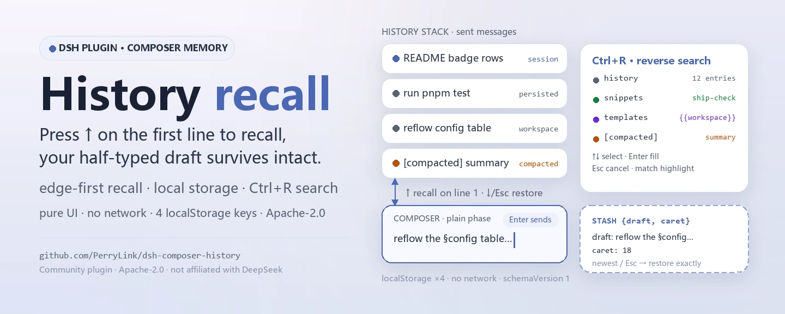
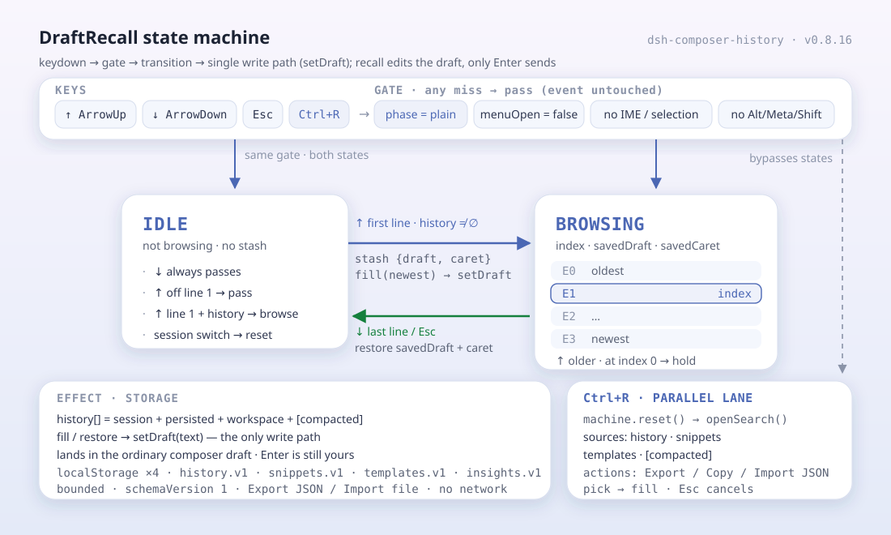

<div align="center">

<picture>
  <source media="(prefers-color-scheme: dark)" srcset="docs/assets/dsh-composer-history-hero-en-dark.webp">
  
</picture>

# dsh-composer-history

**टर्मिनल की तरह ↑ दबाएँ — और आधा लिखा ड्राफ़्ट ज्यों का त्यों बचा रहे।**

DeepSeek Harness Web GUI कंपोज़र के लिए टर्मिनल-शैली का इनपुट इतिहास: एज-फर्स्ट ऐरो रिकॉल, ब्राउज़र-लोकल पर्सिस्टेंस, `Ctrl+R` रिवर्स सर्च और स्निपेट/टेम्पलेट लाइब्रेरी — सब कुछ केवल सामान्य ड्राफ़्ट में।

[इंस्टॉल](#तीन-चरणों-में-शुरुआत) · [कॉन्फ़िगरेशन](#कॉन्फ़िगरेशन) · [FAQ](#faq) · [简体中文](README.md) · [English](README.en.md) · [Español](README.es.md) · [Português](README.pt.md) · [हिन्दी](README.hi.md)

[](LICENSE)
[](#संगतता)
[](https://www.npmjs.com/package/dsh-composer-history)
[](https://github.com/PerryLink/dsh-composer-history/actions/workflows/ci.yml)
[](#संगतता)

[](https://github.com/PerryLink/dsh-composer-history/stargazers)
[](https://www.npmjs.com/package/dsh-composer-history)
[](https://dshfind.com/plugins/PerryLink/dsh-composer-history?ref=badge)
[](https://securityscorecards.dev/viewer/?uri=github.com/PerryLink/dsh-composer-history)
[](https://dsh.market/)
[](https://gitee.com/perrylink/dsh-composer-history)

```sh
dsh plugin --profile <name> add dsh-composer-history
```

</div>

<sub>सामुदायिक प्लगइन, DeepSeek से असंबद्ध। कैनोनिकल रिपॉज़िटरी: <https://github.com/PerryLink/dsh-composer-history> (Gitee एक मिरर है)।</sub>

## यह क्या है

यह टर्मिनल के इनपुट इतिहास को DeepSeek Harness के वेब कंपोज़र में लाता है: कर्सर पहली लाइन पर हो तो ↑ आपके भेजे आख़िरी संदेश को रिकॉल करता है; कहीं और हो तो ↑/↓ कर्सर सामान्य रूप से घुमाते हैं और कोई कुंजी नहीं छीनता।

पहला रिकॉल `{draft, caret}` को सहेजता है, और नवीनतम एंट्री पर दोबारा पहुँचने (या `Esc` दबाने) पर दोनों बिल्कुल वैसे ही बहाल होते हैं — आधा लिखा ड्राफ़्ट कभी नहीं मिटता। इतिहास ब्राउज़र-लोकल स्टोरेज में रहता है, इसलिए रिकॉल पेज रीलोड के बाद भी बचा रहता है और सत्रों के पार जाता है; `Ctrl+R` इतिहास, स्निपेट और टेम्पलेट तीनों में एक साथ खोजता है। जब harness कॉन्टेक्स्ट को ऑटो-कॉम्पैक्ट करता है, हर चेकपॉइंट का सारांश `[compacted] …` एंट्री के रूप में रिकॉल और सर्च में जुड़ जाता है, और एक क्षणिक सूचना एक-क्लिक `/compact` भरने की सुविधा देती है।

शुद्ध UI व्यवहार: कोई सत्र ईवेंट नहीं, कोई agent-loop बदलाव नहीं, कोई मॉडल अनुरोध नहीं। रिकॉल किया गया टेक्स्ट केवल सामान्य कंपोज़र ड्राफ़्ट में जाता है; मॉडल तक वह तभी पहुँचता है जब आप Enter दबाते हैं।

<div align="center">

<picture>
  <source media="(prefers-color-scheme: dark)" srcset="docs/assets/dsh-composer-history-flow-v5-dark.svg">
  
</picture>

</div>

## तीन चरणों में शुरुआत

1. **इंस्टॉल करें** (कोई एक चैनल चुनें):

   ```sh
   # git चैनल (नवीनतम main; git+https://github.com/PerryLink/dsh-composer-history.git के बराबर)
   dsh plugin --profile web add github:PerryLink/dsh-composer-history
   # npm चैनल (प्रकाशित रिलीज़)
   dsh plugin --profile web add dsh-composer-history
   # tarball चैनल: इस रेपो में pnpm pack के बाद
   dsh plugin --profile web add ./dsh-composer-history-<version>.tgz
   ```

   npm पैकेज बने हुए बंडल के साथ आता है; सोर्स checkout को पहले बनाना होता है (`pnpm run build`) — क्लाइंट-पैकेज जाँच बिना बने बंडल के बूट होने से मना कर देती है।

2. **न्यूनतम कॉन्फ़िग** (डिफ़ॉल्ट ही काफ़ी हैं; बंडल पैच एक पंक्ति जोड़ता है और बाक़ी `Config` स्कीमा देता है):

   ```yaml
   - insert:
       - id: composer-history
         name: dsh-composer-history
   ```

3. **जाँचें कि माउंट हुआ**:

   ```sh
   dsh --profile web --dump-config | grep -A3 'id: composer-history'
   ```

   आउटपुट में `id: composer-history` और `name: dsh-composer-history` दिखना चाहिए। रीस्टार्ट के बाद वेब कंपोज़र की पहली लाइन पर कर्सर रखकर ↑ दबाएँ: नवीनतम यूज़र संदेश ड्राफ़्ट में भर जाएगा।

**अनइंस्टॉल**: `dsh plugin --profile web remove dsh-composer-history` (या प्रोफ़ाइल पैच से वह पंक्ति हटा दें)।

<details>
<summary>DSH Desktop मार्केट से इंस्टॉल करें</summary>

हर PerryLink प्लगइन DSH Desktop के अंतर्निहित मार्केट में मिलता है: **मार्केट → स्रोत → स्रोत जोड़ें → चिपकाएँ** `https://perrylink-dsh-catalog.perrylink.workers.dev/catalog-source.json` **→ चुनें**। इंस्टॉल के लिए अब भी मार्केट की npm पहचान जाँच और आपकी पुष्टि ज़रूरी है।

</details>

## मुख्य क्षमताएँ

`dsh-composer-history` एक ही काम करता है: कंपोज़र को याद रहे कि आपने क्या भेजा, और ज़रूरत पर वही चीज़ ज्यों की त्यों लौट आए।

1. **एज-फर्स्ट ऐरो रिकॉल** — साधारण ↑/↓ पहले कर्सर घुमाते हैं; इतिहास रिकॉल तभी शुरू होता है जब कर्सर पहली/आख़िरी लाइन पर हो। पहला रिकॉल `{draft, caret}` को सहेजता है, और नवीनतम एंट्री पर दोबारा पहुँचने (या `Esc` दबाने) पर दोनों बिल्कुल वैसे ही बहाल होते हैं — कभी मिटते नहीं।
2. **पर्सिस्टेंट इतिहास** — हर भेजा गया संदेश एक सीमित ब्राउज़र-लोकल स्टोर में जुड़ता है, इसलिए रिकॉल पेज रीलोड के बाद भी बचा रहता है और सत्रों के पार पहुँचता है।
3. **रिवर्स सर्च** — `Ctrl+R` (कॉन्फ़िगर करने योग्य) मिले हुए इतिहास, स्निपेट और टेम्पलेट पर एक क्वेरी ओवरले खोलता है।
4. **स्मार्ट इनपुट लेयर** — `/save`/`/load` स्निपेट, `{{workspace}}`/`{{session}}`/`{{draft}}` वेरिएबल वाले प्रॉम्प्ट टेम्पलेट, और ब्राउज़र-लोकल पुनः-उपयोग इनसाइट।
5. **स्लाइडिंग-कॉन्टेक्स्ट के प्रति सजग** — कॉम्पैक्शन सारांश `[compacted] …` एंट्री के रूप में रिकॉल और सर्च में शामिल होते हैं, और हर कॉम्पैक्शन पर एक-क्लिक `/compact` भरने वाला क्षणिक सूचना-संदेश आता है।
6. **वर्ज़नयुक्त JSON बैकअप** — चारों लाइब्रेरी (इतिहास, स्निपेट, टेम्पलेट, इनसाइट) को एक ही स्कीमा-वर्ज़न वाले दस्तावेज़ के रूप में निर्यात/आयात करें; निर्यात पर डाउनलोड या कॉपी, आयात पर फ़ाइल चुनें या पेस्ट करें।

शुद्ध UI व्यवहार: कोई सत्र ईवेंट नहीं, कोई agent-loop बदलाव नहीं, कोई मॉडल अनुरोध नहीं। रिकॉल किया गया टेक्स्ट केवल सामान्य कंपोज़र ड्राफ़्ट में जाता है; मॉडल तक वह तभी पहुँचता है जब *आप* Enter दबाते हैं।

```text
keydown ──interceptor──▶ setDraft ──▶ draft ──Enter──▶ model
                            ▲                              │
                            └──── localStorage ◀───────────┘
                                  dsh.composer-history.v1 · snippets.v1
                                  templates.v1 · insights.v1
```

### कमांड और टूल सतह

| सतह | प्रकार | टिप्पणियाँ |
|---|---|---|
| `ArrowUp` | keybinding | एज-फर्स्ट ↑/↓ रिकॉल — `{draft, caret}` सहेजता है और अंत तक पहुँचने या `Esc` पर दोनों बिल्कुल बहाल करता है |
| `Ctrl+R` | keybinding | मिले हुए इतिहास, स्निपेट और टेम्पलेट पर रिवर्स-सर्च पैनल |
| `/save` | command | मौजूदा ड्राफ़्ट को नाम और टैग वाले स्निपेट के रूप में सहेजें |
| `/load` | command | सहेजा हुआ स्निपेट कर्सर पर डालें |
| `templates` | UI | इतिहास, स्निपेट, टेम्पलेट और इनसाइट का वर्ज़नयुक्त JSON बैकअप निर्यात/आयात (केवल स्पष्ट क्लिक पर) |
| `composer-history` | settings form | प्रोफ़ाइल पंक्ति का अपना जीवित `Config` फ़ॉर्म — हल किया गया कॉन्फ़िग (cordis.yml आधार + प्रोफ़ाइल ओवरराइड) ब्राउज़र आधे तक ले जाता है |

### कीबोर्ड शॉर्टकट

| कुंजी | स्थिति | व्यवहार |
|---|---|---|
| ↑ | IDLE, कर्सर पहली लाइन पर | `{draft, caret}` सहेजें, नवीनतम एंट्री भरें, कर्सर अंत में (इतिहास नहीं → पास) |
| ↑ | BROWSING, कर्सर पहली लाइन पर | पुरानी एंट्री; सबसे पुरानी पर रुक जाता है (इंटरसेप्ट, कोई बदलाव नहीं) |
| ↑ | कर्सर पहली लाइन पर नहीं | पूरी तरह पास (ब्राउज़र कर्सर घुमाता है) |
| ↓ | IDLE | हमेशा पास (सामान्य कर्सर गति) |
| ↓ | BROWSING, कर्सर आख़िरी लाइन पर | नई एंट्री; नवीनतम पर → `savedDraft` + `savedCaret` बहाल → IDLE |
| ↓ | कर्सर आख़िरी लाइन पर नहीं | पूरी तरह पास |
| Esc | BROWSING (`restoreOnEscape: true`) | `savedDraft` + `savedCaret` बहाल → IDLE, इंटरसेप्ट |
| Esc | अन्यथा | पास (मेन्यू/पॉपअप का Escape अर्थ अछूता) |
| Ctrl+↑/↓ | `enableCtrlAlias: true` | साधारण तीरों जैसा ही |
| `searchKeys` chord | कंपोज़र फ़ोकस में, `plain` चरण, कोई मेन्यू/चयन/IME नहीं | रिवर्स सर्च खुलता है; ब्राउज़िंग ख़त्म और दिख रहा टेक्स्ट ड्राफ़्ट बन जाता है |
| Shift/Alt/Meta+तीर, IME, चयन | कोई भी | हमेशा पास |

`upKey`/`downKey`/`escapeKey`/`searchKeys` ऊपर की कुंजियाँ बदल देते हैं; मॉडिफ़ायर नीति (और सर्च chord का सटीक-मॉडिफ़ायर मिलान) नहीं बदलती। सर्च पैनल के अंदर: ↑/↓ मिलान का चयन घुमाते हैं (चुनी हुई पंक्ति दृश्य में स्क्रॉल होती है), Enter भरता है, Esc रद्द करता है, क्लिक चुनता है, पैनल के बाहर क्लिक रद्द करता है; मिले हुए अंश हर पंक्ति में हाइलाइट होते हैं।

### उदाहरण

ये वास्तविक प्रवेश बिंदु हैं; इंस्टॉल के बाद एक चलाएँ।

**विस्तृत उदाहरण** — कमांड `/save`, इनपुट:

```sh
/save ship-check --tag=release,ops
```

आउटपुट:

```text
snippet saved: ship-check
```

*से देखा गया `plugins/dsh-composer-history/README.md §Smart input layer (lines 199-205); code at src/client/index.ts:314-327`*

**विफलता शाखा** — इनपुट:

```text
/load nope
```

आउटपुट:

```text
no snippet named nope (open Ctrl+R search to browse snippets)
```

*से देखा गया `plugins/dsh-composer-history/src/client/index.ts:330-333; plugins/dsh-composer-history/src/client/notice.ts:62-65`*

**संक्षिप्त उदाहरण**: `/load` · `/compact`

## रिवर्स सर्च

- **खोलें**: कंपोज़र फ़ोकस में और इनपुट `plain` चरण में हो तब `searchKeys` chord (यहाँ `Ctrl+R` ब्राउज़र का पेज रीलोड भी रोक देता है — कुंजी केवल कंपोज़र के अंदर खपत होती है)।
- **फ़िल्टर**: मिले हुए इतिहास (मौजूदा सत्र + पर्सिस्टेड + वर्कस्पेस एंट्री) पर सबस्ट्रिंग मिलान; केस-संवेदनशीलता `searchCaseSensitive` तय करता है; मिले हुए अंश हर पंक्ति में हाइलाइट होते हैं।
- **चुनें**: Enter ड्राफ़्ट भरता है और कर्सर अंत में ले जाता है — वही एकमात्र `setDraft` लेखन-पथ जो सामान्य रिकॉल का है। रिकॉल किया गया टेक्स्ट मॉडल तक तभी पहुँचता है जब आप बाद में Enter दबाएँ।
- **रद्द करें**: Esc या पैनल के बाहर क्लिक; ड्राफ़्ट अछूता रहता है।

## स्मार्ट इनपुट लेयर

टर्मिनल-शैली इतिहास के ऊपर तीन ब्राउज़र-लोकल लाइब्रेरी कंपोज़र को पुनः प्रयोग योग्य इनपुट सतह बना देती हैं। नीचे सब कुछ `localStorage` में रहता है (कुंजियाँ `dsh.composer-history.snippets.v1`, `.templates.v1`, `.insights.v1`), कभी नेटवर्क नहीं छूता, और हर स्विच एक `Config` फ़ील्ड है।

**स्निपेट (सत्रों के पार कमांड लाइब्रेरी)**

```text
/save ship-check --tag=release,ops
check the build, run the smoke suite, tag the release        ← ड्राफ़्ट का बाक़ी हिस्सा ही स्निपेट है
/save ship-check                                             → "snippet saved: ship-check"
/load ship-check                                             → स्निपेट कंपोज़र में भर जाता है
Ctrl+R → सर्च पैनल इतिहास के साथ स्निपेट भी दिखाता है (हरा बैज = नाम)
```

- `/save <नाम>` वह Enter खपत करता है, ड्राफ़्ट (कमांड पंक्ति के अलावा) को kebab-case नाम के नीचे वैकल्पिक टैग के साथ सहेजता है और कंपोज़र ख़ाली कर देता है। सहेजने को कुछ न हो → त्रुटि सूचना, कमांड कभी नहीं भेजता।
- `/load <नाम>` स्निपेट को कर्सर पर डालता है (पूरा ड्राफ़्ट बदलता है, कर्सर अंत में) और उपयोग गिनता है।
- स्कोप: वर्कस्पेस cwd के साथ सहेजे स्निपेट वर्कस्पेस-स्कोप वाले होते हैं; बिना उसके सहेजे गए ग्लोबल। `maxSnippets` लाइब्रेरी की सीमा है; एक ही नाम पर सहेजने से पुराना बदल जाता है।
- प्लगइन कभी भेजता नहीं: हर भरना सामान्य ड्राफ़्ट में जाता है और Enter आपका ही रहता है।

**वेरिएबल वाले प्रॉम्प्ट टेम्पलेट**

टेम्पलेट `{{variable}}` प्लेसहोल्डर वाले सहेजे हुए प्रॉम्प्ट टेक्स्ट हैं। सर्च पैनल उन्हें बैंगनी बैज के साथ दिखाता है; किसी को चुनने पर वेरिएबल जीवित सत्र से भरते हैं और नतीजा डल जाता है। अंतर्निहित वेरिएबल: `{{workspace}}` (सत्र का cwd), `{{session}}` (सत्र id), `{{draft}}` (मौजूदा ड्राफ़्ट)। अज्ञात वेरिएबल वाला टेम्पलेट गायब सूची के साथ ज़ोर से विफल होता है — आधा भरा प्रॉम्प्ट त्रुटि से बुरा है।

पूरी लाइब्रेरी — इतिहास, स्निपेट, टेम्पलेट और इनसाइट — पैनल की **Export JSON / Import file** क्रियाओं से एक ही वर्ज़नयुक्त JSON दस्तावेज़ के रूप में निर्यात/आयात होती है; नीचे **बैकअप निर्यात और आयात** देखें। यह स्पष्ट उपयोगकर्ता क्रिया है; प्लगइन स्वयं कभी फ़ाइल नहीं लिखता।

**पुनः-उपयोग इनसाइट**

हर नया भेजा गया यूज़र संदेश (और हर स्निपेट लोड) सटीक टेक्स्ट-कुंजी वाला एक ब्राउज़र-लोकल उपयोग रिकॉर्ड छोड़ता है। जब आप टाइप करते हैं, ड्राफ़्ट ऐसे प्रॉम्प्ट से मेल खाते ही जो कम से कम `insightMinUses` (डिफ़ॉल्ट 2) सत्रों में इस्तेमाल हुआ हो, कंपोज़र के नीचे एक छोटी सी सूचना `used M× in N sessions` दिखाती है। `enableInsights` से चालू/बंद करें; आँकड़ों में केवल विविक्त टेक्स्ट और काउंटर होते हैं।

**कॉम्पैक्शन सारांश हाइलाइट**

`Ctrl+R` में `[compacted] …` सारांश एम्बर बैज पाते हैं (इतिहास बिना बैज), स्निपेट हरे और टेम्पलेट बैंगनी — पैनल की प्रोवेनेंस एक नज़र में दिखती है। `enableCompactionHighlight` से चालू/बंद करें।

## बैकअप निर्यात और आयात

चारों ब्राउज़र-लोकल लाइब्रेरी एक ही वर्ज़नयुक्त JSON दस्तावेज़ के रूप में निर्यात/आयात होती हैं। पैनल की **Export JSON / Copy JSON / Import file / Paste JSON** क्रियाएँ पूरी तरह ब्राउज़र में चलती हैं: निर्यात पर डाउनलोड या क्लिपबोर्ड पर कॉपी, आयात पर फ़ाइल चुनें या टेक्स्ट चिपकाएँ — कुछ भी अपलोड नहीं होता और कोई होस्ट RPC या नेटवर्क कॉल शामिल नहीं है।

**दस्तावेज़ का आकार**

```json
{
  "schemaVersion": 1,
  "exportedAt": 1735689600000,
  "data": {
    "history": ["…"],
    "snippets": [{ "name": "…", "text": "…", "tags": [], "scope": "global", "createdAt": 0, "updatedAt": 0, "useCount": 0, "lastUsedAt": 0 }],
    "templates": [{ "name": "…", "text": "…", "description": "", "updatedAt": 0 }],
    "insights": [{ "text": "…", "sessions": [], "uses": 0, "lastUsedAt": 0 }]
  }
}
```

**मर्ज और टकराव रणनीति**

- इतिहास एंट्री सादे स्ट्रिंग हैं और सटीक टेक्स्ट पर विविक्त होती हैं; डुप्लिकेट या ख़ाली एंट्री छोड़ दी जाती है, कभी ओवरराइट नहीं होती।
- स्निपेट और टेम्पलेट `name` पर कुंजीबद्ध हैं; इनसाइट सटीक `text` पर। एक ही कुंजी के टकराव में **नवीनतम टाइमस्टैम्प जीतता है** (स्निपेट/टेम्पलेट के लिए `updatedAt`, इनसाइट के लिए `lastUsedAt`); पुराना या बराबर टाइमस्टैम्प वाला आयात छोड़ दिया जाता है, नई कुंजियाँ जोड़ दी जाती हैं।
- आयात `maxPersisted` और `maxSnippets` का पालन करता है; टेम्पलेट और इनसाइट अपनी तय प्रोटोकॉल सीमाओं (`500` प्रत्येक) पर रुकते हैं।
- नतीजे की सूचना बताती है कि कितने रिकॉर्ड लिखे गए और कितने छोड़े गए (पुराने/डुप्लिकेट)।

**स्कीमा वर्ज़निंग**

`schemaVersion` `1` से शुरू होता है। आयात चरणबद्ध माइग्रेशन (एक बार में एक वर्ज़न) चलाते हैं ताकि भविष्य के फ़ॉर्मैट पुराने दस्तावेज़ों को जगह पर ही उन्नत कर सकें। जिस दस्तावेज़ का `schemaVersion` इस बिल्ड की समझ से **नया** है, वह त्रुटि के साथ अस्वीकार होता है — कभी चुपचाप गिराया या आधा-अधूरा मर्ज नहीं होता; माइग्रेट के लिए बहुत पुराना वर्ज़न भी उसी तरह अस्वीकार होता है।

## स्लाइडिंग कॉन्टेक्स्ट

harness कोर हर dsh सत्र को स्लाइडिंग कॉन्टेक्स्ट विंडो देता है, वही वर्कफ़्लो जो Claude Code और Codex देते हैं: जब बातचीत मॉडल की कॉन्टेक्स्ट सीमा के क़रीब पहुँचती है (या प्रोवाइडर ओवरफ़्लो बताता है), harness **ऑटो-कॉम्पैक्ट** करता है — पुराने टर्न `compaction` चेकपॉइंट मार्कर के पीछे सारांशित हो जाते हैं जो ट्रांसक्रिप्ट में दिखता रहता है, मॉडल के पास केवल सारांश और हाल की पूँछ रहती है, और सत्र आगे चलता है। `/compact` माँग पर वही कॉम्पैक्शन चलाता है, और मार्कर एक फैलने योग्य "Context compacted" पंक्ति के रूप में दिखता है।

`dsh-composer-history` कंपोज़र को उस वर्कफ़्लो से जोड़ता है ताकि विंडो के सरकने से आपका टाइपिंग इतिहास कभी न खोए:

- **रिकॉल कॉम्पैक्शन के पार बचा रहता है** — छाया में गए टर्न Chat व्यू के प्रकाशित फ़ाइनलाइज़्ड बातचीत में रहते हैं, इसलिए ↑ चेकपॉइंट से पहले और बाद में भेजे हर संदेश से गुज़रता रहता है।
- **सारांश इतिहास में जुड़ते हैं** — हर चेकपॉइंट का सारांश टेक्स्ट `[compacted] …` एंट्री के रूप में ↑ रिकॉल और `Ctrl+R` सर्च में आता है (स्विच: `includeCompactionSummaries`), इसलिए जो कॉन्टेक्स्ट मॉडल अब शब्दशः नहीं देखता वह एक कुंजी दूर रहता है।
- **कॉम्पैक्शन सूचना** — पेज खुला रहते कोई चेकपॉइंट आए तो एक क्षणिक snackbar उसकी सूचना देता है (Claude Code का "Auto-compacting conversation…" क्षण) सारांश अंश और एक-क्लिक **Fill `/compact`** क्रिया के साथ (`showCompactionNotice`, `compactCommandText`); भरना सामान्य ड्राफ़्ट में जाता है, और केवल आपका Enter उसे भेजता है।
- **सर्च गिनतियाँ** — `Ctrl+R` पैनल अब जीवित `N entries` / `N matches` स्थिति-पंक्ति दिखाता है, और लंबी एंट्री दो पंक्तियों तक सीमित रहती हैं।

> कॉम्पैक्शन स्वयं (सीमाएँ, सारांश मॉडल, `/compact`) harness कोर के compaction प्लगइनों का काम है — यह प्लगइन केवल वे चेकपॉइंट मार्कर देखता है जो Chat व्यू का बातचीत प्रोजेक्शन पहले से प्रकाशित करता है (`uiConversation.binding(id).target('chat').legacy.nodes`), इसलिए यह बिना किसी agent-loop या मॉडल-अनुरोध बदलाव के काम करता है।

## कॉन्फ़िगरेशन

सभी ट्यून-योग्य विकल्प Schemastery `Config` फ़ील्ड हैं (cordis.yml और एंट्री के सेटिंग्स फ़ॉर्म से बदले जा सकते हैं; प्रोफ़ाइल पैच ही स्थायी दस्तावेज़ है)। id-लक्षित ओवरराइड पूरी पंक्ति बदल देता है — ज़रूरत की हर कुंजी दोबारा लिखें। अमान्य enum मान पूरे dsh बूट को ज़ोर से विफल करते हैं, और सेटिंग्स-फ़ॉर्म का संपादन स्थायी होने से पहले होस्ट द्वारा जाँचा जाता है।

सबसे अधिक उपयोग होने वाली कुंजियाँ:

| कुंजी | डिफ़ॉल्ट | अर्थ |
|---|---|---|
| `recallWithDraft` | `'save'` | रिकॉल मोड (`save` / `gate`): `save` रिकॉल से पहले ग़ैर-ख़ाली ड्राफ़्ट सहेजता है; `gate` केवल ख़ाली ड्राफ़्ट पर रिकॉल करता है (Claude/Codex-शैली गेटिंग) |
| `restoreOnEscape` | `true` | `Esc` से ब्राउज़िंग ख़त्म होने पर सहेजा ड्राफ़्ट बहाल करें |
| `edgeMode` | `'logical'` | एज पहचान मोड (`logical` / `visual`): `\n` पंक्तियों से या मापी गई लिपटी पंक्तियों से |
| `maxHistory` | `500` | अधिकतम रिकॉल-योग्य एंट्री (नवीनतम रखी जाती हैं); `0` = असीमित |
| `historyScope` | `'session'` | इतिहास स्कोप (`session` / `workspace`): `workspace` अन्य सूचीबद्ध सत्रों के यूज़र संदेश मौजूदा सत्र से पहले जोड़ता है |
| `enableSearch` | `true` | `Ctrl+R` रिवर्स-सर्च पैनल सक्षम करें |
| `maxSnippets` | `200` | अधिकतम संग्रहीत स्निपेट; `0` = असीमित |

<details>
<summary>पूर्ण कॉन्फ़िगरेशन तालिका (25 कुंजियाँ)</summary>

| कुंजी | डिफ़ॉल्ट | अर्थ |
|---|---|---|
| `recallWithDraft` | `'save'` | रिकॉल मोड (`save` / `gate`): `save` रिकॉल से पहले ग़ैर-ख़ाली ड्राफ़्ट सहेजता है; `gate` केवल ख़ाली ड्राफ़्ट पर रिकॉल करता है (Claude/Codex-शैली गेटिंग) |
| `restoreOnEscape` | `true` | `Esc` से ब्राउज़िंग ख़त्म होने पर सहेजा ड्राफ़्ट बहाल करें |
| `edgeMode` | `'logical'` | एज पहचान मोड (`logical` / `visual`): `\n` पंक्तियों से या मापी गई लिपटी पंक्तियों से |
| `enableCtrlAlias` | `true` | Ctrl+↑/↓ को साधारण तीरों जैसा व्यवहार कराएँ |
| `restoreCaret` | `true` | अंत तक पहुँचने / `Esc` पर सहेजा कर्सर भी बहाल करें |
| `upKey` | `'ArrowUp'` | ऊपर रिकॉल करने वाला `KeyboardEvent.key`; `''` अक्षम करता है |
| `downKey` | `'ArrowDown'` | नई ओर बढ़ने / बहाल करने वाला `KeyboardEvent.key`; `''` अक्षम करता है |
| `escapeKey` | `'Escape'` | ब्राउज़िंग से बाहर निकलने वाला `KeyboardEvent.key`; `''` अक्षम करता है |
| `maxHistory` | `500` | अधिकतम रिकॉल-योग्य एंट्री (नवीनतम रखी जाती हैं); `0` = असीमित |
| `includeKinds` | `['user']` | इतिहास में स्वीकार्य बातचीत नोड प्रकार (steer संदेश जोड़ने के लिए `'steering'` जोड़ें) |
| `historyScope` | `'session'` | इतिहास स्कोप (`session` / `workspace`): `workspace` अन्य सूचीबद्ध सत्रों के यूज़र संदेश मौजूदा सत्र से पहले जोड़ता है |
| `persistHistory` | `true` | भेजे गए संदेश ब्राउज़र-लोकल स्टोर में जोड़ें |
| `maxPersisted` | `200` | अधिकतम पर्सिस्टेड एंट्री; `0` = असीमित |
| `enableSearch` | `true` | `Ctrl+R` रिवर्स-सर्च पैनल सक्षम करें |
| `searchKeys` | `['Ctrl+R']` | सर्च खोलने वाले chord स्पेक (मॉडिफ़ायर `Ctrl`/`Alt`/`Meta`/`Shift` + एक कुंजी नाम); ग़लत स्पेक ब्राउज़र फ़ाइबर को ज़ोर से विफल करता है |
| `searchCaseSensitive` | `false` | सर्च में अक्षरों का केस भेद करें या नहीं |
| `includeCompactionSummaries` | `true` | `[compacted] …` चेकपॉइंट सारांश रिकॉल और सर्च में स्वीकारें |
| `showCompactionNotice` | `true` | कॉम्पैक्शन चेकपॉइंट आने पर क्षणिक सूचना दिखाएँ |
| `compactCommandText` | `'/compact'` | सूचना की "Compact now" क्रिया कंपोज़र में जो स्लैश कमांड भरती है; `''` क्रिया छिपा देता है |
| `enableSnippets` | `true` | स्निपेट लाइब्रेरी सक्षम करें (`/save`, `/load`, सर्च पैनल से चयन) |
| `maxSnippets` | `200` | अधिकतम संग्रहीत स्निपेट; `0` = असीमित |
| `enableTemplates` | `true` | प्रॉम्प्ट टेम्पलेट लाइब्रेरी सक्षम करें (डालते समय वेरिएबल भरते हैं) |
| `enableInsights` | `true` | पुनः-उपयोग इनसाइट संकेत सक्षम करें (स्थानीय उपयोग आँकड़े) |
| `insightMinUses` | `2` | पुनः-उपयोग संकेत दिखने से पहले न्यूनतम उपयोग |
| `enableCompactionHighlight` | `true` | सर्च पैनल में `[compacted] …` सारांशों को अलग बैज दें |

</details>

अपने प्रोफ़ाइल पैच में ओवरराइड का उदाहरण:

```yaml
- insert:
    - id: composer-history
      name: dsh-composer-history
      config:
        recallWithDraft: gate
        maxHistory: 1000
        historyScope: workspace
```

## FAQ

<details>
<summary>डेटा असल में कहाँ रहता है? क्या अपलोड हो सकता है?</summary>

चार ब्राउज़र-लोकल `localStorage` कुंजियाँ: `dsh.composer-history.v1` (भेजे गए संदेशों का इतिहास), `dsh.composer-history.snippets.v1` (स्निपेट टेक्स्ट + टैग + उपयोग काउंटर), `dsh.composer-history.templates.v1` (टेम्पलेट टेक्स्ट) और `dsh.composer-history.insights.v1` (विविक्त प्रॉम्प्ट टेक्स्ट + प्रति-सत्र उपयोग काउंटर)। सब सीमित, केवल समान-मूल (same-origin) से पढ़ने योग्य और कभी अपलोड नहीं; ख़राब पेलोड चुपचाप रीसेट हो जाते हैं। ब्राउज़र से बाहर जाने का एकमात्र रास्ता वह बैकअप निर्यात है जिस पर आप स्पष्ट क्लिक करते हैं (डाउनलोड या क्लिपबोर्ड)।

</details>

<details>
<summary>होस्ट कंपोज़र DOM बदल दे तो क्या होगा? चुपचाप बिगड़ जाएगा?</summary>

हाँ — यही ज्ञात सीमा #1 है। इंटरसेप्शन होस्ट के निजी DOM पर टिका है: `[data-input-scroll]` के अंदर contenteditable `div[data-composer-input]` (साथ में 0.1.1-rc.2 तक की पुरानी textarea कंपोज़र)। यह प्रकाशित API नहीं है (अपस्ट्रीम प्रस्ताव C3 दर्ज करता है कि प्लगइन होस्ट DOM का केवल अंदाज़ा लगा सकते हैं), इसलिए भविष्य में DOM बदलने पर इंटरसेप्शन चुपचाप टूट सकता है। compat वर्कफ़्लो का jsdom स्मोक पैक किए बंडल के विरुद्ध वह सतह फिर से जाँचता है, जिससे रिग्रेशन रिलीज़ से बाहर रहता है।

</details>

<details>
<summary>क्या यह दूसरे प्लगइनों से कुंजियाँ या स्लॉट छीनता है?</summary>

नहीं। यह केवल `plain` इनपुट चरण में, कंपोज़र फ़ोकस में होने पर इंटरसेप्ट करता है; स्लैश मेन्यू, कमांड पॉपअप, IME कंपोज़िशन, टेक्स्ट चयन और मॉडिफ़ायर संयोजन हमेशा पास होते हैं, और `Enter` कभी इंटरसेप्ट नहीं होता। `Ctrl+R` केवल कंपोज़र के अंदर खपत होता है, कभी ग्लोबल शॉर्टकट के रूप में नहीं। यह कोई सर्विस कुंजी नहीं देता, कोई HTTP रूट पंजीकृत नहीं करता, कोई ग्लोबल नहीं बदलता और कोई सत्र ईवेंट नहीं छोड़ता। बिंदु-दर-बिंदु तर्क "अन्य DSH प्लगइनों के साथ इंटरऑपरेबिलिटी" में है।

</details>

<details>
<summary>प्रदर्शन पर कितना ख़र्च है?</summary>

शुद्ध फ़्रंट-एंड DOM/JS: कोई नेटवर्क नहीं, कोई मॉडल कॉल नहीं, और सामान्य रिकॉल एक ही `setDraft` है। डिफ़ॉल्ट `edgeMode: 'logical'` बिना माप के `\n` से एज तय करता है; `visual` मोड छिपे mirror से असली लिपटन मापता है — प्रति एज जाँच O(पंक्तियाँ·log n) की बाइनरी सर्च, ड्राफ़्ट और चौड़ाई के अनुसार memoize।

</details>

<details>
<summary>रिकॉल की गई एंट्री ग़लती से भेजी जा सकती है?</summary>

नहीं। रिकॉल, स्निपेट लोड, टेम्पलेट भरना और `/compact` भरना सब सामान्य `setDraft` से जाते हैं; `Enter` कभी इंटरसेप्ट नहीं होता और कोई भी रास्ता आपकी ओर से नहीं भेजता। रिकॉल किया गया टेक्स्ट ब्राउज़र से बाहर तभी जाता है जब आप Enter दबाते हैं।

</details>

## सुरक्षा सीमाएँ

- **केवल UI, कभी प्रवर्तन नहीं।** प्लगइन केवल कंपोज़र ड्राफ़्ट संपादित करता है; सैंडबॉक्स, अनुमोदन और सत्र प्रणाली ही प्रवर्तन के अधिकारी रहते हैं, और कोई कमांड या टूल न दावा किया जाता है न बायपास।
- **कोई सामग्री ब्राउज़र से बाहर नहीं जाती।** इतिहास, स्निपेट, टेम्पलेट और इनसाइट `localStorage` में रहते हैं; कुछ अपलोड नहीं होता, कोई मॉडल अनुरोध या नेटवर्क कॉल नहीं होता। वर्ज़नयुक्त बैकअप केवल स्पष्ट क्लिक पर स्थानीय डाउनलोड या क्लिपबोर्ड लिखता है।
- **ज़ोर से विफल।** अमान्य enum मान पूरे dsh बूट को विफल करते हैं; ग़लत सर्च chord ब्राउज़र फ़ाइबर को विफल करता है — ग़लत कॉन्फ़िग कभी चुपचाप कमज़ोर नहीं पड़ता।
- **सब कुछ सीमित।** `maxHistory`, `maxPersisted` और `maxSnippets` रखी गई एंट्री सीमित करते हैं; ख़राब या बाहरी पेलोड चुपचाप रीसेट हो जाते हैं।
- **पास-थ्रू पर शून्य दुष्प्रभाव।** प्लगइन केवल `plain` इनपुट चरण में इंटरसेप्ट करता है और स्लैश मेन्यू, कमांड पॉपअप, IME कंपोज़िशन, टेक्स्ट चयन तथा मॉडिफ़ायर संयोजनों को पास जाने देता है।

## अनुमतियाँ और डेटा

- **अनुमतियाँ**: प्लगइन अपने workshop manifest में `browser:local-storage` घोषित करता है — बस इतना ही। कोई नेटवर्क नहीं, कोई सबप्रोसेस नहीं, कोई सत्र ईवेंट नहीं।
- **डेटा**: चार ब्राउज़र-लोकल `localStorage` कुंजियाँ (इतिहास, स्निपेट, टेम्पलेट, इनसाइट); नियम ऊपर FAQ #1 में हैं — सब सीमित, केवल same-origin, कभी अपलोड नहीं, और ख़राब पेलोड चुपचाप रीसेट।
- **मॉडल को दिखता है ⟺ आप Enter दबाते हैं**: रिकॉल किया गया टेक्स्ट, स्निपेट लोड, टेम्पलेट भरना और `/compact` भरना सब सामान्य कंपोज़र ड्राफ़्ट में जाते हैं। आपके Enter दबाने तक कुछ भी मॉडल तक नहीं पहुँचता।

## ज्ञात सीमाएँ

- **कंपोज़र DOM सतह।** इंटरसेप्शन होस्ट के निजी DOM पर टिका है: `[data-input-scroll]` के अंदर contenteditable `div[data-composer-input]` (harness 0.1.2-alpha.5 / 0.1.2-rc.1 और बाद के); `[data-input-scroll]` के अंदर पुरानी textarea कंपोज़र (0.1.1-rc.2 तक की पंक्तियाँ) भी मेल खाती रहती है। यह आकार प्रकाशित API नहीं है (अपस्ट्रीम प्रस्ताव C3 दर्ज करता है कि प्लगइन होस्ट DOM का केवल अंदाज़ा लगा सकते हैं), इसलिए भविष्य में होस्ट DOM बदलने पर इंटरसेप्शन चुपचाप टूट सकता है — compat वर्कफ़्लो का jsdom स्मोक पैक किए बंडल के विरुद्ध उस सतह को फिर से जाँचता है।
- **लॉजिकल बनाम विज़ुअल पंक्तियाँ।** डिफ़ॉल्ट `logical` `\n` पर आधारित है (लंबा अपने-आप लिपटा संदेश एक पंक्ति गिना जाता है); `visual` असली लिपटन छिपे mirror से मापता है जो contenteditable सतह का computed box कॉपी करता है (प्रति एज जाँच O(पंक्तियाँ·log n) बाइनरी सर्च, प्रति ड्राफ़्ट/चौड़ाई memoized)। mirror माप को असली लेआउट इंजन चाहिए — शुद्ध span गणित के यूनिट टेस्ट हैं, और Lexical कंपोज़र पर मापे गए span best-effort रहते हैं (`logical` ही डिफ़ॉल्ट है)।
- **पर्सिस्टेड इतिहास प्रति-ब्राउज़र है।** स्टोर एक origin के `localStorage` में रहता है; यह ब्राउज़रों या मशीनों के बीच कभी सिंक नहीं होता। ख़राब पेलोड चुपचाप रीसेट हो जाते हैं।
- **अनडू स्टैक में रिकॉल ट्रांज़ैक्शन शामिल हैं।** हर भरना/बहाली इनपुट मशीन के अनडू लॉग में एक `setDraft` ट्रांज़ैक्शन है; Ctrl+Z रिकॉल से एक-एक क़दम पीछे जाता है। सटीकता के लिए अपस्ट्रीम को edit-range उजागर करना होगा।
- `/xxx` एंट्री रिकॉल करके Enter दबाने पर सामान्य command claim/adjudication पथ चलता है (अपेक्षित, और Enter कभी इंटरसेप्ट नहीं होता)।
- मेन्यू/पॉपअप और `plain` के अलावा चरण हमेशा जीतते हैं; भेजा गया संदेश और सत्र बदलाव दोनों IDLE पर रीसेट करते हैं।
- संदर्भ चिप (U+FFFC प्लेसहोल्डर) रिकॉल/बहाल किए गए ड्राफ़्ट टेक्स्ट के साथ चलते हैं।
- `historyScope: 'workspace'` अन्य सूचीबद्ध सत्रों के Chat लक्ष्य पढ़ता है; जिस सत्र का Chat व्यू इस पेज पर सक्रिय नहीं हुआ, वह अभी कुछ योगदान नहीं देता।
- सर्च पैनल सादा DOM है (React पर निर्भर नहीं); यह `maxHistory` सीमा तक सभी मिलान दिखाता है।
- **कॉम्पैक्शन जानकारी अवलोकनात्मक है।** इंस्टॉल से पहले (या सत्र बदलने से पहले) आ चुके चेकपॉइंट कभी सूचना नहीं देते; जिस चेकपॉइंट का सारांश ईवेंट लोड हुई विंडो से बाहर गिरा, वह कोई `[compacted] …` एंट्री नहीं देता (`summary: null`)।
- सूचना की "Compact now" क्रिया केवल तय कमांड टेक्स्ट ड्राफ़्ट में *भरती* है — भेजना उपयोगकर्ता के Enter पर ही है।
- **स्निपेट, टेम्पलेट और इनसाइट ब्राउज़र-लोकल हैं।** नाम kebab-case होते हैं (1..64 अक्षर); टैग 8 × 32 अक्षरों तक। टेम्पलेट वेरिएबल जीवित सत्र से हल होते हैं; `{{draft}}` चुनते समय का ड्राफ़्ट है।

## अन्य DSH प्लगइनों के साथ इंटरऑपरेबिलिटी

ब्राउज़र आधा केवल प्रकाशित क्लाइंट पैकेज (`dsh-client-ui-conversation`, `dsh-client-ui-input-trigger`, `dsh-client-ui-settings`) और cordis `Context` पर चलता है, इसलिए प्लगइन स्तर पर छीनने-झपटने को कुछ नहीं है:

- **कोई सत्र ईवेंट नहीं, कोई agent-loop बदलाव नहीं।** प्लगइन केवल Chat व्यू का प्रकाशित बातचीत प्रोजेक्शन देखता है (`uiConversation.binding(id).target('chat').legacy.nodes`); यह कोई सत्र ईवेंट नहीं जोड़ता और कोई मॉडल अनुरोध नहीं करता।
- **कोई सर्विस कुंजी नहीं।** होस्ट आधे का `inject` ख़ाली ऐरे है और यह कोई सर्विस कुंजी नहीं देता, इसलिए सर्विस-कुंजी टकराव संभव ही नहीं।
- **कोई HTTP रूट नहीं।** यह कोई `webServer` प्रीफ़िक्स पंजीकृत नहीं करता।
- **कोई ग्लोबल बदलाव नहीं।** यह प्रोटोटाइप पैच नहीं करता, `process.env` नहीं बदलता और ग्लोबल fetch dispatcher नहीं बदलता।
- **अपनी सेटिंग्स सतह।** 0.1.7-alpha.1 से यह `composer-history` नेमस्पेस पंजीकृत नहीं करता; यह अपनी जीवित `Config` एंट्री इस्तेमाल करता है (प्रोफ़ाइल पंक्ति id ही फ़ॉर्म का नाम है) और किसी अन्य प्लगइन का सेटिंग्स सेक्शन न पढ़ता है न लिखता है।
- **न्यूनतम इंटरसेप्शन।** यह केवल `plain` इनपुट चरण में, कंपोज़र फ़ोकस में होने पर इंटरसेप्ट करता है; मेन्यू/पॉपअप, IME, चयन और मॉडिफ़ायर संयोजन हमेशा जीतते हैं; `Enter` कभी इंटरसेप्ट नहीं होता।

एकमात्र जुड़ाव-बिंदु होस्ट का निजी DOM (`div[data-composer-input]`) है, जो ज्ञात सीमा #1 में दर्ज है; compat वर्कफ़्लो का jsdom स्मोक पैक किए बंडल के विरुद्ध वह सतह फिर से जाँचता है, जिससे ऐसा बहाव रिलीज़ से बाहर रहता है।

## संगतता

| सतह | स्थिति |
|---|---|
| Harness | DeepSeek Harness `dsh-v0.2.1-rc.2` (2026-10-18 सत्यापित): `engines.dsh >=0.2.1-0 <0.3.0`; P0 संगतता पथों के रिग्रेशन टेस्ट हैं। |
| Node | `^22.19.0 \|\| >=24.9.0` |
| प्लेटफ़ॉर्म | केवल Web GUI (क्लाइंट प्लगइन; ब्राउज़र-लोकल स्टोरेज; कोई नेटवर्क नहीं, कोई नेटिव कोड नहीं) |
| मॉडल | कोई भी (कोई मॉडल अनुरोध नहीं — शुद्ध UI व्यवहार) |

ब्राउज़र आधा प्रकाशित क्लाइंट पैकेज (`dsh-client-ui-conversation`, `dsh-client-ui-input-trigger`, `dsh-client-ui-settings`) और cordis `Context` पर टिका है; यह अब हटाए गए `dsh-client-runtime` पैकेज पर निर्भर नहीं है, इसलिए क्लाइंट सतह `0.1.2-rc.1` होस्ट के साथ भी मेल खाती है।

इंटरसेप्शन वेब कंपोज़र के DOM पर टिका है: `[data-input-scroll]` के अंदर contenteditable सतह `div[data-composer-input]` (0.1.2-alpha.5 / 0.1.2-rc.1 से आने वाला Lexical कंपोज़र), साथ में `[data-input-scroll]` के अंदर पुरानी textarea कंपोज़र (0.1.1-rc.2 तक की harness पंक्तियाँ) भी मेल खाती है; बाक़ी जगह के textarea पास हो जाते हैं। compat वर्कफ़्लो का jsdom web-व्यवहार स्मोक पैक किए बंडल के विरुद्ध इस पहचान/टेक्स्ट/कर्सर सतह की जाँच करता है।

0.1.2-rc.1 (2026-09-04 अनुकूलित): सत्र एनवलप अपना ignorable फ़ील्ड केवल संग्रहीत-लॉग पढ़ने की संगतता के लिए रखता है — `Session.append` अब भी उसे स्टांप नहीं कर सकता, इसलिए ऑडिट-गेट व्यवहार नहीं बदलता। 2026-09-06 को `dsh-v0.1.7-alpha.1` master checkout के विरुद्ध सत्यापित (पूरी गेट श्रृंखला + प्रोफ़ाइल इंस्टॉल स्मोक)।

0.1.5-rc.1 (2026-09-10 अनुकूलित): डिपेंडेंसी पिन प्रकाशित `0.1.5-rc.1` लाइन पर चले जाते हैं; कोई seam बदलाव इस प्लगइन के व्यवहार को प्रभावित नहीं करता।

0.1.5-rc.2 (2026-09-11 अनुकूलित): डिपेंडेंसी पिन प्रकाशित `0.1.5-rc.2` लाइन पर चले जाते हैं; कोई seam बदलाव इस प्लगइन के व्यवहार को प्रभावित नहीं करता।

0.1.7-alpha.1 (2026-09-22 अनुकूलित): सेटिंग्स seam दोनों आधों में बदल दिया गया है। होस्ट आधा अब हटाए गए `ctx.settings.register(ns, schema, { base })` से `composer-history` नेमस्पेस पंजीकृत नहीं करता — इस लाइन पर प्लगइन की स्थायी सेटिंग्स सतह उसका अपना जीवित `Config` ही है: हर ट्यून-योग्य विकल्प `.volatile()` घोषित है, प्रोफ़ाइल एंट्री id (`composer-history`, यानी bundle patch की पंक्ति id) फ़ॉर्म का नाम है, और `apply` जनरेट किए फ़ॉर्म की प्रस्तुति-नीति दावा करता है (`ctx.settings.configure({ auto: true }, ctx.fiber)`, effect के स्वामित्व में ताकि reload पर साफ़ पुनः-पंजीकरण हो)। ब्राउज़र आधा वही एंट्री हटाए गए `ctx.settingsScope.bind({ namespace })` के बजाय `ctx.configForms.get('composer-history')` से पढ़ता है; snapshot/subscribe आकार नहीं बदला, इसलिए हर स्वीकृत बदलाव पर वायरिंग फिर लगती है। संपादन-योग्य सतह संरक्षित है, बढ़ाई नहीं गई: पुराने नेमस्पेस ने जो भी फ़ील्ड दिखाए थे वे सब volatile हैं, और कोई नया फ़ील्ड संपादन-योग्य नहीं बना। `settings.yaml` में मौजूद `composer-history` नाम का सेक्शन होस्ट स्वयं उसी id की प्रोफ़ाइल एंट्री में माइग्रेट कर देता है।

## इकोसिस्टम और गुणवत्ता

- [Gitee मिरर](https://gitee.com/perrylink/dsh-composer-history) (सिंक मिरर; GitHub ही कैनोनिकल है)
- [dshfind प्लगइन पेज](https://dshfind.com/plugins/PerryLink/dsh-composer-history) (इंस्टॉल और रैंकिंग)
- [OpenSSF Scorecard रिपोर्ट](https://securityscorecards.dev/viewer/?uri=github.com/PerryLink/dsh-composer-history) ([.github/workflows/scorecard.yml](.github/workflows/scorecard.yml) से संचालित)
- [dsh-plugin-doctor सत्यापन रिपोर्ट](https://github.com/PerryLink/dsh-plugin-doctor#verified-徽章) (इस रेपो का [.github/workflows/plugin-doctor.yml](.github/workflows/plugin-doctor.yml) हर push/PR पर स्थिर R+K मानदंड चलाता है)
- [DSH Market](https://dsh.market/) (सूचीबद्ध)
- **1024 स्टोर चैनल**: एक बार `npm i -g dsh1024`, फिर `dsh1024 plugin --profile web add dsh-composer-history` ([deepseek1024.com](https://deepseek1024.com) की इंस्टॉल रैंकिंग में गिना जाता है)
- [इकोसिस्टम ज्ञानकोश](https://perrylink.github.io/dsh-plugin-guide/) — मापा गया डेटा, मार्केटिंग नहीं: प्लगइन विकास गाइड · चयन डेटा · रखरखाव के मानदंड

## डेवलपमेंट

```sh
pnpm install           # node ^22.19 || >=24.9
pnpm run build         # tsc build + tsdown bundle (lib/)
pnpm run typecheck     # tsc --noEmit (src + tests)
pnpm test              # vitest run
pnpm run test:watch    # vitest watch
pnpm run test:coverage # vitest run --coverage
pnpm run check:readmes # पाँच भाषाओं के README की संगति गेट
pnpm run verify:pack   # पैक-सतह जाँच
```

README की तस्वीरें [`scripts/gen-readme-assets.py`](scripts/gen-readme-assets.py) से प्रोग्रामेटिक रूप से बनती हैं (hero के लिए Pillow, संरचना चित्र के लिए हाथ से लिखा SVG) और दोबारा चलाना सुरक्षित है: `python scripts/gen-readme-assets.py` `docs/assets/dsh-composer-history-hero-{zh,en}-{light,dark}.webp` और `docs/assets/dsh-composer-history-flow-v5-{light,dark}.svg` लिखता है (hero स्थानीयकृत, संरचना चित्र केवल कमांड टोकन, पाँचों भाषाओं में साझा)।

विषय: `deepseek-harness` · `dsh` · `dsh-plugin` · `web-gui` · `input-history` · `keyboard-shortcuts` · `compaction` · `sliding-context` · `typescript`

## परिवार और आभार

यह प्रोजेक्ट [PerryLink](https://github.com/PerryLink) के DeepSeek Harness प्लगइन परिवार का सदस्य है (सभी Apache-2.0)। अगर यह उपयोगी है, तो **एक स्टार अगले व्यक्ति को इसे खोजने में मदद करता है** — इसके पीछे कुछ भी बंद नहीं है।

- [@gengwg](https://github.com/gengwg) — volatile बूट कॉन्फ़िग हैंडलिंग (#11)।
- [@yujethrozheng-crypto](https://github.com/yujethrozheng-crypto) — 0.2.1-rc.2 पर कंपोज़र इतिहास बहाली (#12); rc.2 बूट फ़िक्स 0.8.15 में आया।
- [@PerryLink](https://github.com/PerryLink) — निर्माता और अनुरक्षक: एज-फर्स्ट ऐरो रिकॉल, पर्सिस्टेंट इतिहास, रिवर्स सर्च, स्लाइडिंग-कॉन्टेक्स्ट जागरूकता, स्निपेट लाइब्रेरी, प्रॉम्प्ट टेम्पलेट, पुनः-उपयोग इनसाइट, और `dsh.bundle` / `dshWorkshop` manifest।

<details>
<summary>सभी प्लगइन विस्तारित करें</summary>

| प्लगइन | स्थिति |
|---|---|
| **[dsh-aqua-input-check](https://github.com/PerryLink/dsh-aqua-input-check)** |  |
| **[dsh-archive-check](https://github.com/PerryLink/dsh-archive-check)** |  |
| **[dsh-auto-review](https://github.com/PerryLink/dsh-auto-review)** |  |
| **[dsh-autotier](https://github.com/PerryLink/dsh-autotier)** | 🧊 फ़्रोज़न — रेपो README देखें |
| **[dsh-bid-ca-precheck](https://github.com/PerryLink/dsh-bid-ca-precheck)** |  |
| **[dsh-bid-qual-check](https://github.com/PerryLink/dsh-bid-qual-check)** |  |
| **[dsh-cert-mcp](https://github.com/PerryLink/dsh-cert-mcp)** | 🧊 फ़्रोज़न — रेपो README देखें |
| **[dsh-checkpoint-rewind](https://github.com/PerryLink/dsh-checkpoint-rewind)** |  |
| **[dsh-click](https://github.com/PerryLink/dsh-click)** |  |
| **[dsh-composer-history](https://github.com/PerryLink/dsh-composer-history)** |  |
| **[dsh-contract-stance](https://github.com/PerryLink/dsh-contract-stance)** |  |
| **[dsh-customs-doc-check](https://github.com/PerryLink/dsh-customs-doc-check)** |  |
| **[dsh-data-quality](https://github.com/PerryLink/dsh-data-quality)** | 🧊 फ़्रोज़न — रेपो README देखें |
| **[dsh-demurrage-ledger](https://github.com/PerryLink/dsh-demurrage-ledger)** |  |
| **[dsh-doublecheck](https://github.com/PerryLink/dsh-doublecheck)** |  |
| **[dsh-drill-script-check](https://github.com/PerryLink/dsh-drill-script-check)** |  |
| **[dsh-eia-guide-check](https://github.com/PerryLink/dsh-eia-guide-check)** |  |
| **[dsh-emergency-plan](https://github.com/PerryLink/dsh-emergency-plan)** |  |
| **[dsh-essay-rubric-check](https://github.com/PerryLink/dsh-essay-rubric-check)** |  |
| **[dsh-evidence-check](https://github.com/PerryLink/dsh-evidence-check)** |  |
| **[dsh-export-ctl-check](https://github.com/PerryLink/dsh-export-ctl-check)** |  |
| **[dsh-fast](https://github.com/PerryLink/dsh-fast)** |  |
| **[dsh-fmea-table-check](https://github.com/PerryLink/dsh-fmea-table-check)** |  |
| **[dsh-forecast-penalty](https://github.com/PerryLink/dsh-forecast-penalty)** |  |
| **[dsh-fund-research](https://github.com/PerryLink/dsh-fund-research)** |  |
| **[dsh-github](https://github.com/PerryLink/dsh-github)** |  |
| **[dsh-gongwen-flow-check](https://github.com/PerryLink/dsh-gongwen-flow-check)** |  |
| **[dsh-gongwen-word-check](https://github.com/PerryLink/dsh-gongwen-word-check)** |  |
| **[dsh-guard-plan-qc](https://github.com/PerryLink/dsh-guard-plan-qc)** |  |
| **[dsh-hazchem-check](https://github.com/PerryLink/dsh-hazchem-check)** |  |
| **[dsh-hazplan-check](https://github.com/PerryLink/dsh-hazplan-check)** |  |
| **[dsh-hidden-risk-map](https://github.com/PerryLink/dsh-hidden-risk-map)** |  |
| **[dsh-hs-classify](https://github.com/PerryLink/dsh-hs-classify)** |  |
| **[dsh-icd-rule-check](https://github.com/PerryLink/dsh-icd-rule-check)** |  |
| **[dsh-industry-research](https://github.com/PerryLink/dsh-industry-research)** |  |
| **[dsh-lawcite-adapter](https://github.com/PerryLink/dsh-lawcite-adapter)** |  |
| **[dsh-laya](https://github.com/PerryLink/dsh-laya)** |  |
| **[dsh-lc-doc-check](https://github.com/PerryLink/dsh-lc-doc-check)** |  |
| **[dsh-learning-gap-check](https://github.com/PerryLink/dsh-learning-gap-check)** |  |
| **[dsh-library](https://github.com/PerryLink/dsh-library)** |  |
| **[dsh-local-ai](https://github.com/PerryLink/dsh-local-ai)** |  |
| **[dsh-lsp-actions](https://github.com/PerryLink/dsh-lsp-actions)** |  |
| **[dsh-mask](https://github.com/PerryLink/dsh-mask)** |  |
| **[dsh-mcp-panel](https://github.com/PerryLink/dsh-mcp-panel)** |  |
| **[dsh-medrec-qc](https://github.com/PerryLink/dsh-medrec-qc)** |  |
| **[dsh-memento](https://github.com/PerryLink/dsh-memento)** | 🧊 फ़्रोज़न — रेपो README देखें |
| **[dsh-nsfc-form-check](https://github.com/PerryLink/dsh-nsfc-form-check)** |  |
| **[dsh-nurse-record-check](https://github.com/PerryLink/dsh-nurse-record-check)** |  |
| **[dsh-observe](https://github.com/PerryLink/dsh-observe)** |  |
| **[dsh-origin-rvc-check](https://github.com/PerryLink/dsh-origin-rvc-check)** |  |
| **[dsh-ota-review-check](https://github.com/PerryLink/dsh-ota-review-check)** |  |
| **[dsh-output-styles](https://github.com/PerryLink/dsh-output-styles)** |  |
| **[dsh-paper-doc-adapter](https://github.com/PerryLink/dsh-paper-doc-adapter)** |  |
| **[dsh-permission-rules](https://github.com/PerryLink/dsh-permission-rules)** |  |
| **[dsh-permit-report-check](https://github.com/PerryLink/dsh-permit-report-check)** |  |
| **[dsh-pipeline-check](https://github.com/PerryLink/dsh-pipeline-check)** |  |
| **[dsh-pleading-draft](https://github.com/PerryLink/dsh-pleading-draft)** |  |
| **[dsh-plugin-doctor](https://github.com/PerryLink/dsh-plugin-doctor)** | 🚫 रिटायर्ड (रेपो संग्रहीत) |
| **[dsh-plugin-guide](https://github.com/PerryLink/dsh-plugin-guide)** |  |
| **[dsh-plugin-kit](https://github.com/PerryLink/dsh-plugin-kit)** | 🚫 रिटायर्ड (रेपो संग्रहीत) |
| **[dsh-plugin-upgrade](https://github.com/PerryLink/dsh-plugin-upgrade)** | 🚫 रिटायर्ड (रेपो संग्रहीत) |
| **[dsh-policy-brief-draft](https://github.com/PerryLink/dsh-policy-brief-draft)** |  |
| **[dsh-power-loss-split](https://github.com/PerryLink/dsh-power-loss-split)** |  |
| **[dsh-power-ticket-check](https://github.com/PerryLink/dsh-power-ticket-check)** |  |
| **[dsh-ppap-check](https://github.com/PerryLink/dsh-ppap-check)** |  |
| **[dsh-protest-deadline](https://github.com/PerryLink/dsh-protest-deadline)** |  |
| **[dsh-railway-window](https://github.com/PerryLink/dsh-railway-window)** |  |
| **[dsh-repair-order-qc](https://github.com/PerryLink/dsh-repair-order-qc)** |  |
| **[dsh-research-report](https://github.com/PerryLink/dsh-research-report)** |  |
| **[dsh-review-reply-check](https://github.com/PerryLink/dsh-review-reply-check)** |  |
| **[dsh-rulefile-check](https://github.com/PerryLink/dsh-rulefile-check)** |  |
| **[dsh-safety-brief-check](https://github.com/PerryLink/dsh-safety-brief-check)** |  |
| **[dsh-score](https://github.com/PerryLink/dsh-score)** | 🧊 फ़्रोज़न — रेपो README देखें |
| **[dsh-session-sync](https://github.com/PerryLink/dsh-session-sync)** |  |
| **[dsh-site-log-check](https://github.com/PerryLink/dsh-site-log-check)** |  |
| **[dsh-skill-pack-security](https://github.com/PerryLink/dsh-skill-pack-security)** |  |
| **[dsh-soe-decision-check](https://github.com/PerryLink/dsh-soe-decision-check)** |  |
| **[dsh-soilwater-check](https://github.com/PerryLink/dsh-soilwater-check)** |  |
| **[dsh-sop-sync-check](https://github.com/PerryLink/dsh-sop-sync-check)** |  |
| **[dsh-spc-gbt-adapter](https://github.com/PerryLink/dsh-spc-gbt-adapter)** |  |
| **[dsh-talk](https://github.com/PerryLink/dsh-talk)** |  |
| **[dsh-tender-extract](https://github.com/PerryLink/dsh-tender-extract)** |  |
| **[dsh-tender-matrix](https://github.com/PerryLink/dsh-tender-matrix)** |  |
| **[dsh-test-drive](https://github.com/PerryLink/dsh-test-drive)** |  |
| **[dsh-ticktick](https://github.com/PerryLink/dsh-ticktick)** | 🚫 रिटायर्ड (रेपो संग्रहीत) |
| **[dsh-translate](https://github.com/PerryLink/dsh-translate)** |  |
| **[dsh-warranty-calc](https://github.com/PerryLink/dsh-warranty-calc)** |  |
| **[dsh-budget](https://github.com/PerryLink/dsh-budget)** | 🧊 फ़्रोज़न — रेपो README देखें |
| **[dsh-claude-move](https://github.com/PerryLink/dsh-claude-move)** | 🧊 फ़्रोज़न — रेपो README देखें |
| **[dsh-defend](https://github.com/PerryLink/dsh-defend)** | 🧊 फ़्रोज़न — रेपो README देखें |
| **[dsh-draw](https://github.com/PerryLink/dsh-draw)** | 🧊 फ़्रोज़न — रेपो README देखें |
| **[dsh-reach](https://github.com/PerryLink/dsh-reach)** | 🧊 फ़्रोज़न — रेपो README देखें |
| **[dsh-background-agents](https://github.com/PerryLink/dsh-background-agents)** | 🚫 रिटायर्ड (रेपो संग्रहीत) |
| **[dsh-session-pin](https://github.com/PerryLink/dsh-session-pin)** | 🚫 रिटायर्ड (रेपो संग्रहीत) |
| **[dsh-team-rooms](https://github.com/PerryLink/dsh-team-rooms)** | 🚫 रिटायर्ड (रेपो संग्रहीत) |

</details>

## लाइसेंस

[LICENSE](LICENSE) (Apache License 2.0) © 2026 dsh-composer-history contributors

<p align="center"><sub>Apache-2.0 · सामुदायिक प्लगइन, DeepSeek से असंबद्ध।</sub></p>
