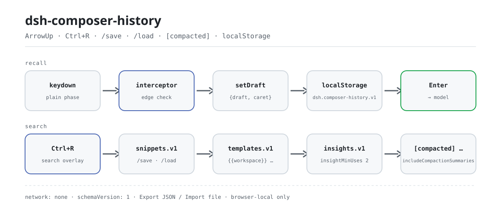

<div align="center">

<picture>
  <source media="(prefers-color-scheme: dark)" srcset="docs/assets/dsh-composer-history-flow-dark.svg">
  
</picture>

# dsh-composer-history

**Pressione ↑ como num terminal — e mantenha intacto o rascunho pela metade.**

Histórico de entrada estilo terminal para o compositor da Web GUI do DeepSeek Harness: recall com setas com prioridade de borda, persistência local no navegador, busca inversa com `Ctrl+R` e bibliotecas de snippets e templates, tudo apenas no rascunho comum.

[Instalar](#instalação-em-três-passos) · [Configuração](#configuração) · [FAQ](#faq) · [简体中文](README.md) · [English](README.en.md) · [Español](README.es.md) · [Português](README.pt.md) · [हिन्दी](README.hi.md)

[](LICENSE)
[](#compatibilidade)
[](https://www.npmjs.com/package/dsh-composer-history)
[](https://github.com/PerryLink/dsh-composer-history/actions/workflows/ci.yml)
[](#compatibilidade)

[](https://github.com/PerryLink/dsh-composer-history/stargazers)
[](https://www.npmjs.com/package/dsh-composer-history)
[](https://dshfind.com/plugins/PerryLink/dsh-composer-history?ref=badge)
[](https://securityscorecards.dev/viewer/?uri=github.com/PerryLink/dsh-composer-history)
[](https://dsh.market/)
[](https://gitee.com/perrylink/dsh-composer-history)

```sh
dsh plugin --profile <name> add dsh-composer-history
```

</div>

<sub>Plugin da comunidade, sem afiliação com a DeepSeek. Repositório canônico: <https://github.com/PerryLink/dsh-composer-history> (o Gitee é um espelho).</sub>

## O que é

Ele leva o histórico de entrada de um terminal para o compositor web do DeepSeek Harness: com o cursor na primeira linha, ↑ recupera a última mensagem que você enviou; em qualquer outra posição, ↑/↓ movem o cursor normalmente e nada se apodera da tecla.

O primeiro recall guarda `{draft, caret}`, e ao voltar à entrada mais recente (ou pressionar `Esc`) os dois são restaurados exatamente — seu rascunho pela metade nunca é apagado. O histórico vive no armazenamento local do navegador, então o recall sobrevive a recarregamentos e atravessa sessões; `Ctrl+R` busca ao mesmo tempo em histórico, snippets e templates. Quando o harness autocompacta o contexto, o resumo de cada checkpoint entra no recall e na busca como entrada `[compacted] …`, e um aviso transitório oferece preencher `/compact` com um clique.

Comportamento puramente de UI: sem eventos de sessão, sem mudanças no agent-loop, sem requisições ao modelo. O texto recuperado só entra no rascunho comum do compositor, e só chega ao modelo se você pressionar Enter.

## Instalação em três passos

1. **Instalar** (escolha um canal):

   ```sh
   # canal git (main mais recente; equivale a git+https://github.com/PerryLink/dsh-composer-history.git)
   dsh plugin --profile web add github:PerryLink/dsh-composer-history
   # canal npm (versões publicadas)
   dsh plugin --profile web add dsh-composer-history
   # canal tarball: após pnpm pack neste repositório
   dsh plugin --profile web add ./dsh-composer-history-<version>.tgz
   ```

   O pacote npm já traz os bundles construídos; um checkout do código-fonte precisa ser construído antes (`pnpm run build`) — a checagem do pacote cliente se recusa a iniciar com um bundle sem build.

2. **Configuração mínima** (os padrões bastam; o patch do bundle insere uma linha e o schema `Config` fornece o resto):

   ```yaml
   - insert:
       - id: composer-history
         name: dsh-composer-history
   ```

3. **Verificar que monta**:

   ```sh
   dsh --profile web --dump-config | grep -A3 'id: composer-history'
   ```

   A saída deve mostrar `id: composer-history` e `name: dsh-composer-history`. Depois de reiniciar, coloque o cursor na primeira linha do compositor web e pressione ↑: a mensagem de usuário mais recente preenche o rascunho.

**Desinstalar**: `dsh plugin --profile web remove dsh-composer-history` (ou remova a linha do patch do perfil).

<details>
<summary>Instalar pelo mercado do DSH Desktop</summary>

Todos os plugins PerryLink aparecem no mercado embutido do DSH Desktop: **Mercado → Fontes → Adicionar fonte → colar** `https://perrylink-dsh-catalog.perrylink.workers.dev/catalog-source.json` **→ selecionar**. A instalação continua exigindo a verificação de identidade npm do mercado e a sua confirmação.

</details>

## Capacidades principais

O `dsh-composer-history` faz uma coisa: faz o compositor lembrar do que você enviou e devolver isso intacto quando precisar.

1. **Recall com setas com prioridade de borda** — as setas ↑/↓ simples movem o cursor primeiro; o recall do histórico só dispara quando o cursor está na primeira/última linha. O primeiro recall guarda `{draft, caret}`, e ao voltar à entrada mais recente (ou pressionar `Esc`) os dois são restaurados exatamente — nunca apagados.
2. **Histórico persistido** — cada mensagem enviada é anexada a um armazenamento local do navegador limitado, então o recall sobrevive a recarregamentos e alcança outras sessões.
3. **Busca inversa** — `Ctrl+R` (configurável) abre um painel de consulta sobre histórico, snippets e templates combinados.
4. **Camada de entrada inteligente** — snippets `/save`/`/load`, templates de prompt com variáveis `{{workspace}}`/`{{session}}`/`{{draft}}` e insights de reutilização locais do navegador.
5. **Consciente do contexto deslizante** — resumos de compactação entram no recall e na busca como entradas `[compacted] …`, e um aviso transitório anuncia cada compactação com um preenchimento de `/compact` de um clique.
6. **Backup JSON versionado** — exporta/importa as quatro bibliotecas (histórico, snippets, templates, insights) como um único documento com versão de schema; download ou cópia ao exportar, arquivo ou colagem ao importar.

Comportamento puramente de UI: sem eventos de sessão, sem mudanças no agent-loop, sem requisições ao modelo. O texto recuperado só entra no rascunho comum do compositor; só chega ao modelo se *você* pressionar Enter.

```text
keydown ──interceptor──▶ setDraft ──▶ draft ──Enter──▶ model
                            ▲                              │
                            └──── localStorage ◀───────────┘
                                  dsh.composer-history.v1 · snippets.v1
                                  templates.v1 · insights.v1
```

### Superfície de comandos e ferramentas

| Superfície | Tipo | Notas |
|---|---|---|
| `ArrowUp` | keybinding | Recall ↑/↓ com prioridade de borda — guarda `{draft, caret}` e restaura os dois exatamente ao chegar ao fim ou pressionar `Esc` |
| `Ctrl+R` | keybinding | Painel de busca inversa sobre histórico, snippets e templates combinados |
| `/save` | command | Salva o rascunho atual como snippet nomeado e com tags |
| `/load` | command | Insere um snippet salvo no cursor |
| `templates` | UI | Exportação/importação de backup JSON versionado de histórico, snippets, templates e insights (apenas com clique explícito) |
| `composer-history` | settings form | O formulário `Config` vivo da própria linha do perfil — leva a configuração resolvida (base do cordis.yml + overrides do perfil) para a metade do navegador |

### Atalhos de teclado

| Tecla | Estado | Comportamento |
|---|---|---|
| ↑ | IDLE, cursor na primeira linha | guarda `{draft, caret}`, preenche a entrada mais recente, cursor no fim (sem histórico → passa) |
| ↑ | BROWSING, cursor na primeira linha | entrada mais antiga; para na mais antiga (intercepta, sem mutação) |
| ↑ | cursor fora da primeira linha | totalmente liberado (o navegador move o cursor) |
| ↓ | IDLE | sempre liberado (movimento normal do cursor) |
| ↓ | BROWSING, cursor na última linha | entrada mais recente; na mais recente → restaura `savedDraft` + `savedCaret` → IDLE |
| ↓ | cursor fora da última linha | totalmente liberado |
| Esc | BROWSING (`restoreOnEscape: true`) | restaura `savedDraft` + `savedCaret` → IDLE, interceptado |
| Esc | caso contrário | liberado (a semântica de Escape de menus e popups não muda) |
| Ctrl+↑/↓ | `enableCtrlAlias: true` | igual às setas simples |
| `searchKeys` chord | compositor focado, fase `plain`, sem menu/seleção/IME | abre a busca inversa; a navegação termina e o texto exibido vira o rascunho |
| Shift/Alt/Meta+setas, IME, seleção | qualquer | sempre liberado |

`upKey`/`downKey`/`escapeKey`/`searchKeys` renomeiam as teclas acima; a política de modificadores (e a correspondência exata do chord de busca) não muda. Dentro do painel de busca: ↑/↓ movem a seleção de correspondências (a linha selecionada rola para a vista), Enter preenche, Esc cancela, um clique escolhe e um clique fora cancela; as substrings correspondentes são destacadas em cada linha.

### Exemplos

São os pontos de entrada reais; instale e chame um.

**Exemplo detalhado** — comando `/save`, entrada:

```sh
/save ship-check --tag=release,ops
```

Saída:

```text
snippet saved: ship-check
```

*Observado em `plugins/dsh-composer-history/README.md §Smart input layer (lines 199-205); code at src/client/index.ts:314-327`*

**Ramo de falha** — entrada:

```text
/load nope
```

Saída:

```text
no snippet named nope (open Ctrl+R search to browse snippets)
```

*Observado em `plugins/dsh-composer-history/src/client/index.ts:330-333; plugins/dsh-composer-history/src/client/notice.ts:62-65`*

**Exemplos curtos**: `/load` · `/compact`

## Busca inversa

- **Abrir**: o chord `searchKeys` com o compositor focado e a entrada na fase `plain` (aqui `Ctrl+R` também impede o recarregamento da página pelo navegador — a tecla só é consumida dentro do compositor).
- **Filtrar**: correspondência por substring sobre o histórico combinado (sessão atual + persistido + entradas do workspace); a sensibilidade a maiúsculas é decidida por `searchCaseSensitive`; as substrings correspondentes são destacadas em cada linha.
- **Escolher**: Enter preenche o rascunho e leva o cursor ao fim — o mesmo único caminho de escrita `setDraft` do recall comum. O texto recuperado só chega ao modelo se você pressionar Enter depois.
- **Cancelar**: Esc ou um clique fora do painel; o rascunho não é tocado.

## Camada de entrada inteligente

Sobre o histórico estilo terminal, três bibliotecas locais do navegador transformam o compositor numa superfície de entrada reutilizável. Tudo abaixo vive em `localStorage` (chaves `dsh.composer-history.snippets.v1`, `.templates.v1`, `.insights.v1`), nunca toca a rede, e cada interruptor é um campo `Config`.

**Snippets (biblioteca de comandos entre sessões)**

```text
/save ship-check --tag=release,ops
check the build, run the smoke suite, tag the release        ← o resto do rascunho é o snippet
/save ship-check                                             → "snippet saved: ship-check"
/load ship-check                                             → o snippet preenche o compositor
Ctrl+R → o painel de busca lista snippets (selo verde = nome) ao lado do histórico
```

- `/save <nome>` consome o Enter, guarda o rascunho (menos a linha de comando) sob um nome kebab-case com tags opcionais e limpa o compositor. Nada para salvar → aviso de erro, o comando nunca envia.
- `/load <nome>` insere o snippet no cursor (substituição de todo o rascunho, cursor no fim) e conta o uso.
- Escopo: snippets salvos com um cwd de workspace são do workspace; os salvos sem ele são globais. `maxSnippets` limita a biblioteca; salvar com o mesmo nome substitui.
- O plugin nunca envia: todo preenchimento cai no rascunho comum e o seu Enter continua sendo seu.

**Templates de prompt com variáveis**

Templates são textos de prompt guardados com marcadores `{{variable}}`. O painel de busca os lista com selo roxo; escolher um preenche as variáveis a partir da sessão ao vivo e insere o resultado. Variáveis embutidas: `{{workspace}}` (o cwd da sessão), `{{session}}` (o id da sessão), `{{draft}}` (o rascunho atual). Um template com variável desconhecida falha ruidosamente com a lista de faltantes — um prompt pela metade é pior que um erro.

Toda a biblioteca — histórico, snippets, templates e insights — é exportada e importada como um único documento JSON versionado pelas ações **Export JSON / Import file** do painel; veja **Exportação e importação de backup** abaixo. É uma ação explícita do usuário; o plugin nunca grava arquivos sozinho.

**Insights de reutilização**

Cada mensagem de usuário recém-confirmada (e cada carregamento de snippet) deixa um registro local de uso com chave de texto exato. Enquanto você digita, uma pequena dica sob o compositor mostra `used M× in N sessions` assim que o rascunho coincide com um prompt usado em pelo menos `insightMinUses` (padrão 2) sessões. Ative com `enableInsights`; as estatísticas contêm apenas os textos deduplicados e os contadores.

**Destaque de resumos de compactação**

`Ctrl+R` marca os resumos `[compacted] …` com selo âmbar (o histórico sem selo), snippets em verde e templates em roxo — a procedência do painel fica visível num relance. Ative com `enableCompactionHighlight`.

## Exportação e importação de backup

As quatro bibliotecas locais do navegador são exportadas e importadas como um único documento JSON versionado. As ações **Export JSON / Copy JSON / Import file / Paste JSON** do painel rodam inteiramente no navegador: baixar ou copiar para a área de transferência ao exportar, escolher arquivo ou colar texto ao importar — nada é enviado e nenhuma RPC do host ou chamada de rede está envolvida.

**Forma do documento**

```json
{
  "schemaVersion": 1,
  "exportedAt": 1735689600000,
  "data": {
    "history": ["…"],
    "snippets": [{ "name": "…", "text": "…", "tags": [], "scope": "global", "createdAt": 0, "updatedAt": 0, "useCount": 0, "lastUsedAt": 0 }],
    "templates": [{ "name": "…", "text": "…", "description": "", "updatedAt": 0 }],
    "insights": [{ "text": "…", "sessions": [], "uses": 0, "lastUsedAt": 0 }]
  }
}
```

**Estratégia de mesclagem e conflitos**

- As entradas de histórico são strings simples e são deduplicadas por texto exato; uma entrada duplicada ou em branco é ignorada, nunca sobrescrita.
- Snippets e templates usam `name` como chave; insights usam o `text` exato. Em conflito de mesma chave vence **o timestamp mais recente** (`updatedAt` para snippets/templates, `lastUsedAt` para insights); uma importação mais antiga ou de timestamp igual é ignorada, e chaves novas são anexadas.
- A importação respeita `maxPersisted` e `maxSnippets`; templates e insights param nos limites fixos de protocolo (`500` cada).
- O aviso de resultado informa quantos registros foram gravados e quantos foram ignorados (mais antigos/duplicados).

**Versionamento de schema**

`schemaVersion` começa em `1`. As importações executam uma migração passo a passo (uma versão por vez) para que formatos futuros possam atualizar documentos antigos no lugar. Um documento cujo `schemaVersion` seja **mais novo** que o que esta build entende é rejeitado com erro — nunca é descartado em silêncio nem mesclado parcialmente; uma versão antiga demais para migrar é rejeitada do mesmo jeito.

## Contexto deslizante

O núcleo do harness dá a cada sessão dsh uma janela de contexto deslizante, o mesmo fluxo que Claude Code e Codex trazem: quando uma conversa se aproxima do limite de contexto do modelo (ou o provedor reporta transbordo), o harness **autocompacta** — turnos antigos são resumidos atrás de um marcador de checkpoint `compaction` que continua visível na transcrição, o modelo mantém apenas o resumo mais a cauda recente e a sessão continua. `/compact` dispara a mesma compactação sob demanda, e o marcador renderiza como uma linha expansível "Contexto compactado".

O `dsh-composer-history` liga o compositor a esse fluxo para que o deslize da janela nunca custe seu histórico de digitação:

- **O recall sobrevive à compactação** — turnos sombreados continuam na conversa finalizada que a visão Chat publica, então ↑ ainda percorre cada mensagem que você enviou antes e depois de um checkpoint.
- **Resumos entram no histórico** — o texto do resumo de cada checkpoint entra no recall ↑ e na busca `Ctrl+R` como entrada `[compacted] …` (interruptor: `includeCompactionSummaries`), então o contexto que o modelo não vê mais literalmente fica a uma tecla.
- **Aviso de compactação** — quando um checkpoint chega com a página aberta, um snackbar transitório o anuncia (o momento "Auto-compacting conversation…" do Claude Code) com o trecho do resumo e uma ação de um clique **Fill `/compact`** (`showCompactionNotice`, `compactCommandText`); o preenchimento cai no rascunho comum, e só o seu Enter envia.
- **Contagens de busca** — o painel `Ctrl+R` agora mostra uma linha de status ao vivo `N entries` / `N matches`, e entradas longas ficam limitadas a duas linhas.

> A compactação em si (limiares, modelo de resumo, `/compact`) pertence aos plugins de compactação do núcleo do harness — este plugin apenas observa os marcadores de checkpoint que a projeção de conversa da visão Chat já publica (`uiConversation.binding(id).target('chat').legacy.nodes`), então funciona sem mudanças no agent-loop ou nas requisições ao modelo.

## Configuração

Todas as opções são campos Schemastery `Config` (alteráveis pelo cordis.yml e pelo formulário de ajustes da entrada; o patch do perfil é o documento persistido). Um override por id substitui a linha inteira — reenuncie cada chave de que precisa. Valores de enum inválidos derrubam ruidosamente todo o boot do dsh, e o host valida a edição do formulário antes de persistir.

Chaves mais usadas:

| Chave | Padrão | Significado |
|---|---|---|
| `recallWithDraft` | `'save'` | Modo de recall (`save` / `gate`): `save` guarda um rascunho não vazio antes de recuperar; `gate` só recupera com o rascunho vazio (controle estilo Claude/Codex) |
| `restoreOnEscape` | `true` | Restaura o rascunho guardado quando `Esc` encerra a navegação |
| `edgeMode` | `'logical'` | Modo de detecção de borda (`logical` / `visual`): por linhas `\n` ou por linhas quebradas medidas |
| `maxHistory` | `500` | Máximo de entradas recuperáveis (as mais recentes são mantidas); `0` = ilimitado |
| `historyScope` | `'session'` | Escopo do histórico (`session` / `workspace`): `workspace` antepõe mensagens de usuário de outras sessões listadas às da sessão atual |
| `enableSearch` | `true` | Ativa o painel de busca inversa `Ctrl+R` |
| `maxSnippets` | `200` | Máximo de snippets guardados; `0` = ilimitado |

<details>
<summary>Tabela de configuração completa (25 chaves)</summary>

| Chave | Padrão | Significado |
|---|---|---|
| `recallWithDraft` | `'save'` | Modo de recall (`save` / `gate`): `save` guarda um rascunho não vazio antes de recuperar; `gate` só recupera com o rascunho vazio (controle estilo Claude/Codex) |
| `restoreOnEscape` | `true` | Restaura o rascunho guardado quando `Esc` encerra a navegação |
| `edgeMode` | `'logical'` | Modo de detecção de borda (`logical` / `visual`): por linhas `\n` ou por linhas quebradas medidas |
| `enableCtrlAlias` | `true` | Faz Ctrl+↑/↓ se comportar como as setas simples |
| `restoreCaret` | `true` | Restaura também o cursor guardado ao chegar ao fim / com `Esc` |
| `upKey` | `'ArrowUp'` | `KeyboardEvent.key` que recupera para cima; `''` desativa |
| `downKey` | `'ArrowDown'` | `KeyboardEvent.key` que avança para o mais recente / restaura; `''` desativa |
| `escapeKey` | `'Escape'` | `KeyboardEvent.key` que sai da navegação; `''` desativa |
| `maxHistory` | `500` | Máximo de entradas recuperáveis (as mais recentes são mantidas); `0` = ilimitado |
| `includeKinds` | `['user']` | Tipos de nó de conversa admitidos no histórico (adicione `'steering'` para incluir mensagens steer) |
| `historyScope` | `'session'` | Escopo do histórico (`session` / `workspace`): `workspace` antepõe mensagens de usuário de outras sessões listadas às da sessão atual |
| `persistHistory` | `true` | Anexa mensagens enviadas ao armazenamento local do navegador |
| `maxPersisted` | `200` | Máximo de entradas persistidas; `0` = ilimitado |
| `enableSearch` | `true` | Ativa o painel de busca inversa `Ctrl+R` |
| `searchKeys` | `['Ctrl+R']` | Especificações de chord que abrem a busca (modificadores `Ctrl`/`Alt`/`Meta`/`Shift` + uma tecla); uma especificação malformada derruba a fibra do navegador |
| `searchCaseSensitive` | `false` | Se a busca diferencia maiúsculas de minúsculas |
| `includeCompactionSummaries` | `true` | Admite os resumos de checkpoint `[compacted] …` no recall e na busca |
| `showCompactionNotice` | `true` | Mostra um aviso transitório quando um checkpoint de compactação chega |
| `compactCommandText` | `'/compact'` | Comando de barra que a ação "Compact now" do aviso preenche no compositor; `''` oculta a ação |
| `enableSnippets` | `true` | Ativa a biblioteca de snippets (`/save`, `/load`, seleção no painel de busca) |
| `maxSnippets` | `200` | Máximo de snippets guardados; `0` = ilimitado |
| `enableTemplates` | `true` | Ativa a biblioteca de templates de prompt (as variáveis são preenchidas ao inserir) |
| `enableInsights` | `true` | Ativa a dica de reutilização (estatísticas locais de uso) |
| `insightMinUses` | `2` | Usos mínimos antes de mostrar a dica de reutilização |
| `enableCompactionHighlight` | `true` | Marca com selo os resumos `[compacted] …` no painel de busca |

</details>

Exemplo de override no patch do seu perfil:

```yaml
- insert:
    - id: composer-history
      name: dsh-composer-history
      config:
        recallWithDraft: gate
        maxHistory: 1000
        historyScope: workspace
```

## FAQ

<details>
<summary>Onde os dados realmente ficam? Podem ser enviados para fora?</summary>

Quatro chaves `localStorage` locais do navegador: `dsh.composer-history.v1` (histórico de mensagens enviadas), `dsh.composer-history.snippets.v1` (textos de snippets + tags + contadores de uso), `dsh.composer-history.templates.v1` (textos de templates) e `dsh.composer-history.insights.v1` (textos de prompt deduplicados + contadores por sessão). Tudo limitado, apenas da mesma origem e nunca enviado; cargas corrompidas são reiniciadas em silêncio. O único caminho de saída do navegador é a exportação de backup que você clica explicitamente (download ou área de transferência).

</details>

<details>
<summary>E se o host mudar o DOM do compositor? Falha em silêncio?</summary>

Sim — é a limitação conhecida nº 1. A interceptação ancora em DOM privado do host: o `div[data-composer-input]` contenteditable dentro de `[data-input-scroll]` (mais o compositor textarea legado em linhas até 0.1.1-rc.2). Isso não é uma API publicada (a proposta upstream C3 registra que plugins só podem adivinhar o DOM do host), então uma mudança futura do DOM pode quebrar a interceptação em silêncio. O smoke jsdom do fluxo compat reafirma essa face contra o bundle empacotado, mantendo a regressão fora dos lançamentos.

</details>

<details>
<summary>Ele disputa teclas ou slots com outros plugins?</summary>

Não. Ele só intercepta na fase de entrada `plain` com o compositor focado; o menu de barra, os popups de comando, a composição IME, as seleções de texto e as combinações com modificadores sempre passam, e `Enter` nunca é interceptado. `Ctrl+R` é consumido apenas dentro do compositor, nunca como atalho global. Ele não oferece nenhuma chave de serviço, não registra rotas HTTP, não muta globais e não emite eventos de sessão. O argumento ponto a ponto está em "Interoperabilidade com outros plugins DSH".

</details>

<details>
<summary>Qual é o custo de desempenho?</summary>

DOM/JS puro no front-end: sem rede, sem chamadas ao modelo, e um recall comum é um único `setDraft`. O `edgeMode: 'logical'` padrão detecta bordas por `\n` sem medição; o modo `visual` mede as quebras reais com um mirror oculto — uma busca binária O(linhas·log n) por checagem de borda, memoizada por rascunho e largura.

</details>

<details>
<summary>Uma entrada recuperada pode ser enviada por acidente?</summary>

Não. Recall, carregamento de snippets, preenchimento de templates e o preenchimento de `/compact` passam todos pelo `setDraft` comum; `Enter` nunca é interceptado e nenhum caminho envia por você. O texto recuperado só sai do navegador depois que você pressiona Enter.

</details>

## Limites de segurança

- **Só UI, nunca enforcement.** O plugin edita apenas o rascunho do compositor; o sandbox, as aprovações e o sistema de sessões continuam sendo as autoridades de execução, e nenhum comando ou ferramenta é reivindicado ou contornado.
- **Nenhum conteúdo sai do navegador.** Histórico, snippets, templates e insights vivem em `localStorage`; nada é enviado e nenhuma requisição ao modelo ou chamada de rede é feita. O backup versionado só grava um download local ou a área de transferência com um clique explícito.
- **Falha ruidosa.** Valores de enum inválidos derrubam todo o boot do dsh; um chord de busca malformado derruba a fibra do navegador — configuração errada nunca degrada em silêncio.
- **Tudo limitado.** `maxHistory`, `maxPersisted` e `maxSnippets` limitam as entradas retidas; cargas corrompidas ou estranhas são reiniciadas em silêncio.
- **Zero efeitos colaterais ao passar.** O plugin só intercepta na fase de entrada `plain` e cede ao menu de barra, aos popups de comando, à composição IME, às seleções de texto e às combinações com modificadores.

## Permissões e dados

- **Permissões**: o plugin declara `browser:local-storage` no seu manifesto de workshop — nada mais. Sem rede, sem subprocessos, sem eventos de sessão.
- **Dados**: quatro chaves `localStorage` locais do navegador (histórico, snippets, templates, insights); as regras estão na FAQ nº 1 — tudo limitado, apenas da mesma origem, nunca enviado, e cargas corrompidas são reiniciadas em silêncio.
- **Visível ao modelo ⟺ você pressiona Enter**: texto recuperado, carregamentos de snippets, preenchimentos de templates e o preenchimento de `/compact` caem no rascunho comum do compositor. Nada chega ao modelo até você pressionar Enter.

## Limitações conhecidas

- **Face DOM do compositor.** A interceptação ancora em DOM privado do host: o `div[data-composer-input]` contenteditable dentro de `[data-input-scroll]` (harness 0.1.2-alpha.5 / 0.1.2-rc.1 e posteriores); o compositor textarea legado dentro de `[data-input-scroll]` (linhas até 0.1.1-rc.2) continua casando. Essa forma não é uma API publicada (a proposta upstream C3 registra que plugins só podem adivinhar o DOM do host), então uma mudança futura do DOM pode quebrar a interceptação em silêncio — o smoke jsdom do fluxo compat reafirma a face contra o bundle empacotado.
- **Linhas lógicas vs visuais.** O `logical` padrão usa `\n` (uma mensagem longa com quebra automática conta como uma linha); `visual` mede as quebras reais com um mirror oculto que copia a caixa calculada da superfície contenteditable (busca binária O(linhas·log n) por checagem de borda, memoizada por rascunho/largura). A medição do mirror precisa de um motor de layout real — a matemática pura de spans é testada em unidade, e os spans medidos no compositor Lexical continuam best-effort (`logical` segue como padrão).
- **O histórico persistido é por navegador.** O armazenamento vive no `localStorage` de uma origem; nunca sincroniza entre navegadores ou máquinas. Cargas corrompidas são reiniciadas em silêncio.
- **A pilha de desfazer inclui transações de recall.** Cada preenchimento/restauração é uma transação `setDraft` no log de desfazer da máquina de entrada; Ctrl+Z volta pelas recuperações. A correção fina precisa que o upstream exponha o edit-range.
- Recuperar uma entrada `/xxx` e pressionar Enter segue o caminho normal de claim/adjudication de comandos (esperado, e Enter nunca é interceptado).
- Menus/popups e fases diferentes de `plain` sempre ganham; um envio confirmado e trocas de sessão reiniciam para IDLE.
- Chips de referência (marcadores U+FFFC) viajam junto com o texto do rascunho recuperado/restaurado.
- `historyScope: 'workspace'` lê os alvos Chat de outras sessões listadas; uma sessão cuja visão Chat não foi ativada nesta página ainda não contribui.
- O painel de busca é DOM puro (sem dependência de React); renderiza todas as correspondências até o limite `maxHistory`.
- **A consciência de compactação é observacional.** Checkpoints chegados antes da instalação (ou antes de uma troca de sessão) nunca disparam aviso; um checkpoint cujo evento de resumo caiu fora da janela carregada não contribui com entrada `[compacted] …` (`summary: null`).
- A ação "Compact now" do aviso apenas *preenche* o texto de comando configurado no rascunho — o envio continua sendo o Enter do usuário.
- **Snippets, templates e insights são locais do navegador.** Nomes são kebab-case (1..64 caracteres); tags limitadas a 8 × 32 caracteres. As variáveis de template resolvem a partir da sessão ao vivo; `{{draft}}` é o rascunho no momento da escolha.

## Interoperabilidade com outros plugins DSH

A metade do navegador usa apenas pacotes cliente publicados (`dsh-client-ui-conversation`, `dsh-client-ui-input-trigger`, `dsh-client-ui-settings`) e o `Context` do cordis, então no nível do plugin não há nada a disputar:

- **Sem eventos de sessão, sem mudanças no agent-loop.** O plugin só observa a projeção de conversa publicada pela visão Chat (`uiConversation.binding(id).target('chat').legacy.nodes`); não anexa eventos de sessão nem faz requisições ao modelo.
- **Sem chaves de serviço.** A metade host tem um array `inject` vazio e não fornece nenhuma chave de serviço, então não pode colidir em uma.
- **Sem rotas HTTP.** Não registra nenhum prefixo `webServer`.
- **Sem mutação global.** Não aplica patch em protótipos, não reescreve `process.env` nem substitui o dispatcher fetch global.
- **Superfície de ajustes própria.** Desde 0.1.7-alpha.1 não registra mais um namespace `composer-history`; usa sua própria entrada `Config` viva (o id da linha do perfil nomeia o formulário) e não lê nem escreve a seção de ajustes de outro plugin.
- **Interceptação mínima.** Só intercepta na fase de entrada `plain` com o compositor focado; menus/popups, IME, seleções e combinações com modificadores sempre ganham; `Enter` nunca é interceptado.

O único ponto de acoplamento é o DOM privado do host (`div[data-composer-input]`), registrado na limitação conhecida nº 1; o smoke jsdom do fluxo compat reafirma essa face contra o bundle empacotado, mantendo esse desvio fora dos lançamentos.

## Compatibilidade

| Superfície | Status |
|---|---|
| Harness | DeepSeek Harness `dsh-v0.2.1-rc.2` (verificado em 2026-10-18): `engines.dsh >=0.2.1-0 <0.3.0`; os caminhos de compatibilidade P0 têm testes de regressão. |
| Node | `^22.19.0 \|\| >=24.9.0` |
| Plataformas | Apenas Web GUI (plugin cliente; armazenamento local do navegador; sem rede, sem código nativo) |
| Modelo | Qualquer (sem requisições ao modelo — comportamento de UI puro) |

A metade do navegador se apoia nos pacotes cliente publicados (`dsh-client-ui-conversation`, `dsh-client-ui-input-trigger`, `dsh-client-ui-settings`) e no `Context` do cordis; já não depende do pacote `dsh-client-runtime` removido, então a superfície cliente também se alinha com hosts `0.1.2-rc.1`.

A interceptação ancora no DOM do compositor web: a superfície contenteditable `div[data-composer-input]` dentro de `[data-input-scroll]` (o compositor Lexical enviado desde 0.1.2-alpha.5 / 0.1.2-rc.1), com o compositor textarea legado dentro de `[data-input-scroll]` (linhas de harness até 0.1.1-rc.2) ainda casando; textareas de outros lugares passam. O smoke de comportamento web em jsdom do fluxo compat verifica essa face de identidade/texto/cursor contra o bundle empacotado.

0.1.2-rc.1 (adaptado em 2026-09-04): o envelope de sessão mantém seu campo ignorable apenas por compatibilidade de leitura de logs guardados — `Session.append` continua sem poder carimbá-lo, então o comportamento do gate de auditoria não muda. Verificado em 2026-09-06 contra o checkout master `dsh-v0.1.7-alpha.1` (cadeia completa de gates + smoke de instalação de perfil).

0.1.5-rc.1 (adaptado em 2026-09-10): os pinos de dependência passam para a linha publicada `0.1.5-rc.1`; nenhuma mudança de seam afeta o comportamento deste plugin.

0.1.5-rc.2 (adaptado em 2026-09-11): os pinos de dependência passam para a linha publicada `0.1.5-rc.2`; nenhuma mudança de seam afeta o comportamento deste plugin.

0.1.7-alpha.1 (adaptado em 2026-09-22): o seam de ajustes é substituído nas duas metades. A metade host não registra mais um namespace `composer-history` pelo removido `ctx.settings.register(ns, schema, { base })` — nesta linha a superfície de ajustes durável de um plugin É o seu próprio `Config` vivo: cada opção é declarada `.volatile()`, o id da entrada do perfil (`composer-history`, o id da linha do patch do bundle) nomeia o formulário, e `apply` reivindica a apresentação do formulário gerado (`ctx.settings.configure({ auto: true }, ctx.fiber)`, propriedade de um effect para que um reload o registre de novo com limpeza). A metade do navegador lê a mesma entrada via `ctx.configForms.get('composer-history')` em vez do removido `ctx.settingsScope.bind({ namespace })`; a forma de snapshot/subscribe não muda, então a ligação é reinstalada em cada mudança confirmada. A superfície editável é preservada, não ampliada: todo campo que o antigo namespace expunha é volatile, e nenhum campo novo se tornou editável. Uma seção `composer-history` existente em `settings.yaml` é migrada pelo próprio host para a entrada de perfil do mesmo id.

## Ecossistema e qualidade

- [Espelho Gitee](https://gitee.com/perrylink/dsh-composer-history) (espelho sincronizado; o GitHub é o canônico)
- [Página do dshfind](https://dshfind.com/plugins/PerryLink/dsh-composer-history) (instalações e ranking)
- [Relatório OpenSSF Scorecard](https://securityscorecards.dev/viewer/?uri=github.com/PerryLink/dsh-composer-history) (movido por [.github/workflows/scorecard.yml](.github/workflows/scorecard.yml))
- [Relatório de verificação do dsh-plugin-doctor](https://github.com/PerryLink/dsh-plugin-doctor#verified-徽章) (o [.github/workflows/plugin-doctor.yml](.github/workflows/plugin-doctor.yml) deste repositório roda os critérios estáticos R+K em cada push/PR)
- [DSH Market](https://dsh.market/) (listado)
- **Canal da loja 1024**: `npm i -g dsh1024` uma vez, depois `dsh1024 plugin --profile web add dsh-composer-history` (conta para o ranking de instalações do [deepseek1024.com](https://deepseek1024.com))
- [Base de conhecimento do ecossistema](https://perrylink.github.io/dsh-plugin-guide/) — dados medidos, não marketing: guia de desenvolvimento de plugins · dados de seleção · critérios de manutenção

## Desenvolvimento

```sh
pnpm install           # node ^22.19 || >=24.9
pnpm run build         # tsc build + tsdown bundle (lib/)
pnpm run typecheck     # tsc --noEmit (src + tests)
pnpm test              # vitest run
pnpm run test:watch    # vitest watch
pnpm run test:coverage # vitest run --coverage
pnpm run check:readmes # gate de consistência dos cinco README
pnpm run verify:pack   # checagem da superfície do pacote
```

As imagens do README são geradas programaticamente por [`scripts/gen-readme-assets.py`](scripts/gen-readme-assets.py) (Python + Pillow) e é seguro rodar de novo: `python scripts/gen-readme-assets.py` escreve os dois arquivos vetoriais `docs/assets/dsh-composer-history-flow-{light,dark}.svg` (nunca rasterizados; apenas tokens de comando, compartilhados pelos cinco idiomas).

Tópicos: `deepseek-harness` · `dsh` · `dsh-plugin` · `web-gui` · `input-history` · `keyboard-shortcuts` · `compaction` · `sliding-context` · `typescript`

## Família e agradecimentos

Este projeto faz parte da família de plugins do DeepSeek Harness da [PerryLink](https://github.com/PerryLink) (todos Apache-2.0). Se for útil, **uma estrela ajuda a próxima pessoa a encontrá-lo** — nada fica bloqueado por isso.

- [@gengwg](https://github.com/gengwg) — tratamento de configuração volátil no boot (#11).
- [@yujethrozheng-crypto](https://github.com/yujethrozheng-crypto) — restauração do histórico do compositor no 0.2.1-rc.2 (#12); o conserto de boot do rc.2 saiu na 0.8.15.
- [@PerryLink](https://github.com/PerryLink) — criador e mantenedor: recall com setas com prioridade de borda, histórico persistido, busca inversa, consciência do contexto deslizante, biblioteca de snippets, templates de prompt, insights de reutilização e os manifestos `dsh.bundle` / `dshWorkshop`.

<details>
<summary>Expandir todos os plugins</summary>

| Plugin | Status |
|---|---|
| **[dsh-aqua-input-check](https://github.com/PerryLink/dsh-aqua-input-check)** |  |
| **[dsh-archive-check](https://github.com/PerryLink/dsh-archive-check)** |  |
| **[dsh-auto-review](https://github.com/PerryLink/dsh-auto-review)** |  |
| **[dsh-autotier](https://github.com/PerryLink/dsh-autotier)** | 🧊 CONGELADO — ver o README do repo |
| **[dsh-bid-ca-precheck](https://github.com/PerryLink/dsh-bid-ca-precheck)** |  |
| **[dsh-bid-qual-check](https://github.com/PerryLink/dsh-bid-qual-check)** |  |
| **[dsh-cert-mcp](https://github.com/PerryLink/dsh-cert-mcp)** | 🧊 CONGELADO — ver o README do repo |
| **[dsh-checkpoint-rewind](https://github.com/PerryLink/dsh-checkpoint-rewind)** |  |
| **[dsh-click](https://github.com/PerryLink/dsh-click)** |  |
| **[dsh-composer-history](https://github.com/PerryLink/dsh-composer-history)** |  |
| **[dsh-contract-stance](https://github.com/PerryLink/dsh-contract-stance)** |  |
| **[dsh-customs-doc-check](https://github.com/PerryLink/dsh-customs-doc-check)** |  |
| **[dsh-data-quality](https://github.com/PerryLink/dsh-data-quality)** | 🧊 CONGELADO — ver o README do repo |
| **[dsh-demurrage-ledger](https://github.com/PerryLink/dsh-demurrage-ledger)** |  |
| **[dsh-doublecheck](https://github.com/PerryLink/dsh-doublecheck)** |  |
| **[dsh-drill-script-check](https://github.com/PerryLink/dsh-drill-script-check)** |  |
| **[dsh-eia-guide-check](https://github.com/PerryLink/dsh-eia-guide-check)** |  |
| **[dsh-emergency-plan](https://github.com/PerryLink/dsh-emergency-plan)** |  |
| **[dsh-essay-rubric-check](https://github.com/PerryLink/dsh-essay-rubric-check)** |  |
| **[dsh-evidence-check](https://github.com/PerryLink/dsh-evidence-check)** |  |
| **[dsh-export-ctl-check](https://github.com/PerryLink/dsh-export-ctl-check)** |  |
| **[dsh-fast](https://github.com/PerryLink/dsh-fast)** |  |
| **[dsh-fmea-table-check](https://github.com/PerryLink/dsh-fmea-table-check)** |  |
| **[dsh-forecast-penalty](https://github.com/PerryLink/dsh-forecast-penalty)** |  |
| **[dsh-fund-research](https://github.com/PerryLink/dsh-fund-research)** |  |
| **[dsh-github](https://github.com/PerryLink/dsh-github)** |  |
| **[dsh-gongwen-flow-check](https://github.com/PerryLink/dsh-gongwen-flow-check)** |  |
| **[dsh-gongwen-word-check](https://github.com/PerryLink/dsh-gongwen-word-check)** |  |
| **[dsh-guard-plan-qc](https://github.com/PerryLink/dsh-guard-plan-qc)** |  |
| **[dsh-hazchem-check](https://github.com/PerryLink/dsh-hazchem-check)** |  |
| **[dsh-hazplan-check](https://github.com/PerryLink/dsh-hazplan-check)** |  |
| **[dsh-hidden-risk-map](https://github.com/PerryLink/dsh-hidden-risk-map)** |  |
| **[dsh-hs-classify](https://github.com/PerryLink/dsh-hs-classify)** |  |
| **[dsh-icd-rule-check](https://github.com/PerryLink/dsh-icd-rule-check)** |  |
| **[dsh-industry-research](https://github.com/PerryLink/dsh-industry-research)** |  |
| **[dsh-lawcite-adapter](https://github.com/PerryLink/dsh-lawcite-adapter)** |  |
| **[dsh-laya](https://github.com/PerryLink/dsh-laya)** |  |
| **[dsh-lc-doc-check](https://github.com/PerryLink/dsh-lc-doc-check)** |  |
| **[dsh-learning-gap-check](https://github.com/PerryLink/dsh-learning-gap-check)** |  |
| **[dsh-library](https://github.com/PerryLink/dsh-library)** |  |
| **[dsh-local-ai](https://github.com/PerryLink/dsh-local-ai)** |  |
| **[dsh-lsp-actions](https://github.com/PerryLink/dsh-lsp-actions)** |  |
| **[dsh-mask](https://github.com/PerryLink/dsh-mask)** |  |
| **[dsh-mcp-panel](https://github.com/PerryLink/dsh-mcp-panel)** |  |
| **[dsh-medrec-qc](https://github.com/PerryLink/dsh-medrec-qc)** |  |
| **[dsh-memento](https://github.com/PerryLink/dsh-memento)** | 🧊 CONGELADO — ver o README do repo |
| **[dsh-nsfc-form-check](https://github.com/PerryLink/dsh-nsfc-form-check)** |  |
| **[dsh-nurse-record-check](https://github.com/PerryLink/dsh-nurse-record-check)** |  |
| **[dsh-observe](https://github.com/PerryLink/dsh-observe)** |  |
| **[dsh-origin-rvc-check](https://github.com/PerryLink/dsh-origin-rvc-check)** |  |
| **[dsh-ota-review-check](https://github.com/PerryLink/dsh-ota-review-check)** |  |
| **[dsh-output-styles](https://github.com/PerryLink/dsh-output-styles)** |  |
| **[dsh-paper-doc-adapter](https://github.com/PerryLink/dsh-paper-doc-adapter)** |  |
| **[dsh-permission-rules](https://github.com/PerryLink/dsh-permission-rules)** |  |
| **[dsh-permit-report-check](https://github.com/PerryLink/dsh-permit-report-check)** |  |
| **[dsh-pipeline-check](https://github.com/PerryLink/dsh-pipeline-check)** |  |
| **[dsh-pleading-draft](https://github.com/PerryLink/dsh-pleading-draft)** |  |
| **[dsh-plugin-doctor](https://github.com/PerryLink/dsh-plugin-doctor)** | 🚫 APOSENTADO (repo arquivado) |
| **[dsh-plugin-guide](https://github.com/PerryLink/dsh-plugin-guide)** |  |
| **[dsh-plugin-kit](https://github.com/PerryLink/dsh-plugin-kit)** | 🚫 APOSENTADO (repo arquivado) |
| **[dsh-plugin-upgrade](https://github.com/PerryLink/dsh-plugin-upgrade)** | 🚫 APOSENTADO (repo arquivado) |
| **[dsh-policy-brief-draft](https://github.com/PerryLink/dsh-policy-brief-draft)** |  |
| **[dsh-power-loss-split](https://github.com/PerryLink/dsh-power-loss-split)** |  |
| **[dsh-power-ticket-check](https://github.com/PerryLink/dsh-power-ticket-check)** |  |
| **[dsh-ppap-check](https://github.com/PerryLink/dsh-ppap-check)** |  |
| **[dsh-protest-deadline](https://github.com/PerryLink/dsh-protest-deadline)** |  |
| **[dsh-railway-window](https://github.com/PerryLink/dsh-railway-window)** |  |
| **[dsh-repair-order-qc](https://github.com/PerryLink/dsh-repair-order-qc)** |  |
| **[dsh-research-report](https://github.com/PerryLink/dsh-research-report)** |  |
| **[dsh-review-reply-check](https://github.com/PerryLink/dsh-review-reply-check)** |  |
| **[dsh-rulefile-check](https://github.com/PerryLink/dsh-rulefile-check)** |  |
| **[dsh-safety-brief-check](https://github.com/PerryLink/dsh-safety-brief-check)** |  |
| **[dsh-score](https://github.com/PerryLink/dsh-score)** | 🧊 CONGELADO — ver o README do repo |
| **[dsh-session-sync](https://github.com/PerryLink/dsh-session-sync)** |  |
| **[dsh-site-log-check](https://github.com/PerryLink/dsh-site-log-check)** |  |
| **[dsh-skill-pack-security](https://github.com/PerryLink/dsh-skill-pack-security)** |  |
| **[dsh-soe-decision-check](https://github.com/PerryLink/dsh-soe-decision-check)** |  |
| **[dsh-soilwater-check](https://github.com/PerryLink/dsh-soilwater-check)** |  |
| **[dsh-sop-sync-check](https://github.com/PerryLink/dsh-sop-sync-check)** |  |
| **[dsh-spc-gbt-adapter](https://github.com/PerryLink/dsh-spc-gbt-adapter)** |  |
| **[dsh-talk](https://github.com/PerryLink/dsh-talk)** |  |
| **[dsh-tender-extract](https://github.com/PerryLink/dsh-tender-extract)** |  |
| **[dsh-tender-matrix](https://github.com/PerryLink/dsh-tender-matrix)** |  |
| **[dsh-test-drive](https://github.com/PerryLink/dsh-test-drive)** |  |
| **[dsh-ticktick](https://github.com/PerryLink/dsh-ticktick)** | 🚫 APOSENTADO (repo arquivado) |
| **[dsh-translate](https://github.com/PerryLink/dsh-translate)** |  |
| **[dsh-warranty-calc](https://github.com/PerryLink/dsh-warranty-calc)** |  |
| **[dsh-budget](https://github.com/PerryLink/dsh-budget)** | 🧊 CONGELADO — ver o README do repo |
| **[dsh-claude-move](https://github.com/PerryLink/dsh-claude-move)** | 🧊 CONGELADO — ver o README do repo |
| **[dsh-defend](https://github.com/PerryLink/dsh-defend)** | 🧊 CONGELADO — ver o README do repo |
| **[dsh-draw](https://github.com/PerryLink/dsh-draw)** | 🧊 CONGELADO — ver o README do repo |
| **[dsh-reach](https://github.com/PerryLink/dsh-reach)** | 🧊 CONGELADO — ver o README do repo |
| **[dsh-background-agents](https://github.com/PerryLink/dsh-background-agents)** | 🚫 APOSENTADO (repo arquivado) |
| **[dsh-session-pin](https://github.com/PerryLink/dsh-session-pin)** | 🚫 APOSENTADO (repo arquivado) |
| **[dsh-team-rooms](https://github.com/PerryLink/dsh-team-rooms)** | 🚫 APOSENTADO (repo arquivado) |

</details>

## Licença

[LICENSE](LICENSE) (Apache License 2.0) © 2026 dsh-composer-history contributors

<p align="center"><sub>Apache-2.0 · Plugin da comunidade, sem afiliação com a DeepSeek.</sub></p>
